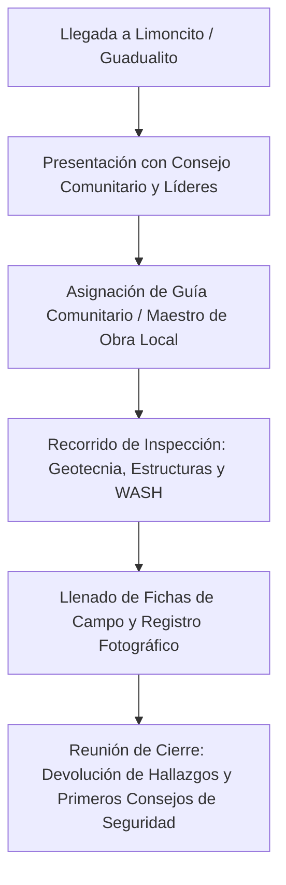
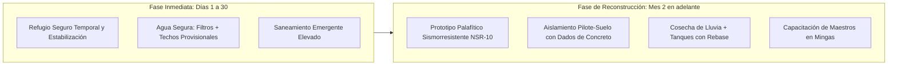

# Guía de Misión de Campo y Evaluación Post-Sismo: Limoncito y Guadualito
**Herramienta de Diagnóstico Ingenieril, Social y Técnico en Territorio**
*Proyecto: Manual del Constructor Popular Colombiano (MDCP) / Hábitat Resiliente del Pacífico*

---

## 1. Contexto Estratégico y Propósito de la Misión

* **Ubicación:** Comunidades de **Limoncito y Guadualito** (Cuenca del Río Dagua / Calima, zona de influencia de Buenaventura, Valle del Cauca).
* **Gobernanza:** Territorios colectivos bajo **Consejos Comunitarios de Comunidades Negras (Ley 70 de 1993)**.
* **Propósito:** 
  1. Evaluar de primera mano las fallas estructurales, riesgos geotécnicos y pérdidas materiales ocasionadas por el sismo.
  2. Identificar las necesidades urgentes y de mediano plazo de las familias afectadas para orientar soluciones reales de ingeniería civil y sanitaria.
  3. Levantar los insumos técnicos de campo indispensables para diseñar viviendas palafíticas progresivas, sismorresistentes y adaptadas al entorno hiperhúmedo del Pacífico colombiano.
  4. Identificar maestros de obra, artesanos locales y líderes comunitarios para validar participativamente el *Manual del Constructor Popular*.

---

## 2. Checklist Pre-Viaje: Preparación, Logística y Respeto Comunitario

Antes de salir al terreno, verifica cada uno de los siguientes puntos:

### A. Protocolo Político-Comunitario (Clave en Territorios Ley 70)
- [ ] **Coordinación previa con la Junta del Consejo Comunitario:** Contactar al Representante Legal o líderes locales para avisar de la visita y solicitar formalmente el ingreso al territorio.
- [ ] **Definición de expectativas:** Clarificar desde el primer contacto que se realiza una misión de **apoyo técnico, evaluación de ingeniería y diagnóstico**, evitando promesas asistenciales o subsidios que dependan de terceros.
- [ ] **Contacto con líderes de minga o comités barriales:** Saber quiénes están coordinando la atención a damnificados en el sitio.

### B. Logística Fluvial y Terrestre en el Pacífico
- [ ] **Tabla de Mareas (Pujas y Quiebras):** Conocer los horarios de pleamar (marea alta) y bajamar (marea baja) si el trayecto involucra zonas de estero o navegación fluvial condicionada.
- [ ] **Coordinación de transporte fluvial seguro:** Lancha con motorista local confiable, motor en buen estado y reserva de combustible (la gasolina en el río puede ser escasa).
- [ ] **Chaleco salvavidas obligatorio** para cada integrante del equipo (norma innegociable en navegación del litoral).
- [ ] **Bolsas y estuches impermeables tipo *dry-bag*:** Para proteger teléfonos, cámaras, documentos, formatos de papel e instrumentos de medición de aguaceros y salpicaduras.

### C. Salud, Autocuidado y Seguridad Personal
- [ ] **Vacunación al día:** Fiebre amarilla y tétanos (fundamental al revisar escombros con maderas astilladas y clavos oxidados).
- [ ] **Botiquín de campo:** Antiséptico, gasas, vendas, suero oral (sales de rehidratación oral), analgésicos, antialérgicos, repelente de insectos de alta concentración (DEET o Icaridina).
- [ ] **Agua potable para consumo propio:** Botellón o botellas de agua seguras + tabletas potabilizadoras o filtro portátil de membrana.
- [ ] **Vestuario y calzado técnico:** Botas de caucho tipo pantaneras de caña alta (imprescindibles en fango y orillas), medias largas, ropa ligera de secado rápido (manga larga para mosquitos y sol), impermeable liviano o poncho de agua y sombrero/gorra.

### D. Caja de Herramientas del Ingeniero de Campo
- [ ] **Cinta métrica metálica (8 m o 10 m)** para medidas de vigas, pilotes, uniones y espesores de muro.
- [ ] **Cinta métrica larga (30 m o 50 m)** o distanciómetro láser para dimensiones de lotes, distanciamiento entre casas y anchos de vía/estero.
- [ ] **Varilla corrugada de sondeo manual (tientón / varilla de 3/8" o 1/2" de 1.5 m) o punzón:** Para palpar la profundidad del estrato fangoso y nivel freático en el terreno.
- [ ] **Nivel de mano (o nivel torpedo con imán / plomada):** Para revisar desplome de pilotes y pandeo de columnas post-sismo.
- [ ] **Higrómetro para madera portátil (opcional pero de altísimo valor):** Para medir el porcentaje de humedad real de las maderas locales en uso.
- [ ] **Libretas de notas impermeables (tipo *Rite in the Rain*) o portapapeles con forro plástico:** En el Pacífico el papel normal se satura de humedad en minutos.
- [ ] **Marcadores indelebles (Sharpie), tiza de marcar y cinta de enmascarar o de peligro (roja/amarilla)** para señalizar puntos críticos.
- [ ] **GPS de mano o app offline en smartphone** (ej. OsmAnd, Gaia GPS, Google Maps offline) con batería externa cargada (*power bank*).
- [ ] **Cámara fotográfica o celular con suficiente memoria libre** (activa la georreferenciación de fotos si la batería lo permite).

---

## 3. Protocolo en Territorio: Llegada e Interacción Comunitaria

1. **Llegada y Presentación:** Dirígete primero a la caseta comunitaria o punto de encuentro del Consejo Comunitario. Saluda con respeto, explica el objetivo técnico y solicita el acompañamiento de un líder o maestro de obra local.
2. **Escucha Activa antes de Medir:** Deja que las familias cuenten cómo vivieron el sismo (*"se mecía como una canoa"*, *"se hundieron los palos"*, *"sonó como un trueno subterráneo"*). Esto te dará pistas exactas de la dirección de la onda, amplificación por suelo blando y duración del evento.
3. **Mapeo Social Rápido:** Identifica con ellos cuántas casas colapsaron totalmente, cuántas están inhabitables, cuántas personas están en albergues improvisados y dónde se están cocinando los alimentos (ollas comunitarias).

---

## 4. Matriz de Levantamiento de Inputs Técnicos de Ingeniería

Al recorrer las zonas afectadas, enfoca tu recolección de datos en estas cinco categorías fundamentales:

### Insumo 1: Geotecnia, Suelo y Respuesta Sísmica Local
* [ ] **Evidencias de Licuación de Suelos:** 
  * ¿Hubo eyección de arena o lodo a través de grietas en el suelo?
  * ¿Se observan volcanes de arena cerca a las orillas del río o estero?
  * ¿Se inclinaron o hundieron postes y pilotes sin rotura evidente del elemento estructural?
* [ ] **Asentamientos Diferenciales:** Medir con nivel o regla cuánto se hundió un lado de la vivienda respecto al otro.
* [ ] **Profundidad del Firme:** Preguntar a los abuelos o constructores locales: ¿a cuántos metros o brazas encuentran terreno "colorado", arcilloso o cascajo firme debajo del fango superficial?
* [ ] **Comportamiento de Orillas y Taludes:** ¿Hubo socavación, desprendimiento de barrancos hacia el río o pérdida de borde costero durante el movimiento telúrico?

### Insumo 2: Hidrología, Mareas e Inundación
* [ ] **Marca de Creciente Máxima Histórica:** Ubicar en los árboles o casas antiguas la marca de la mayor creciente registrada (*"hasta dónde llegó el agua en la peor borrasca"*). Medir esa altura desde el suelo natural.
* [ ] **Efecto de la Marea (Régimen de Pujas):** ¿Hasta dónde entra la marea viva en días de luna llena/nueva?
* [ ] **Cota Mínima de Piso Limpio ($NPT_{min}$):** Determinar la altura recomendada a la que debe quedar la plataforma habitable para que nunca se inunde:
  $$\text{Altura de Plataforma} = \text{Cota Máxima Inundación/Marea} + 0.60\text{ m a }1.00\text{ m de borde libre}$$

### Insumo 3: Patología Estructural (¿Por qué fallaron las viviendas?)

#### A. Viviendas Palafíticas de Madera / Guadua
* [ ] **Falla en la base del pilote:** ¿El pilote se pudrió en la zona de interfase aire-agua-tierra y se partió con el sismo? (La zona más vulnerable siempre son los primeros 30 cm sobre el fango).
* [ ] **Ausencia de arriostramiento transversal y longitudinal:** ¿Los pilotes eran postes verticales libres tipo "patas de araña" sin cruces de San Andrés ($X$) o riostras diagonales? Al faltar arriostramiento, la vivienda oscila violentamente hasta vencer los apoyos.
* [ ] **Tipo de unión y anclaje:** ¿Las vigas maestras estaban apoyadas sobre hombros/rebajes del pilote o simplemente sostenidas por clavos comunes trabajando a corte? (Los clavos lisos suelen deslizarse o cizallarse en sismos).
* [ ] **Estado de la madera:** Identificar si la estructura colapsada tenía comején, pudrición blanda o pudrición blanca previa al sismo.

#### B. Viviendas de Mampostería (Ladrillo / Bloque de Cemento)
* [ ] **Falta de confinamiento sismorresistente (NSR-10 Título E):**
  * ¿Muros sin columnetas ni vigas de corona?
  * ¿Colapso por volteo de muros fuera del plano?
* [ ] **Incompatibilidad de rigidez y peso:** ¿Construyeron losas de concreto pesadas o muros de ladrillo apoyados sobre pilotes de madera delgados? (El peso excesivo sobre suelo blando durante un sismo es catastrófico).

### Insumo 4: Recursos Locales, Cadena de Suministro y Oficios
* [ ] **Especies Maderables Locales Usadas y Disponibles:**
  * Para pilotes (sumergidos o en contacto con tierra): ¿Hay Nato (*Mora megistosperma*), Guayacán, Chanul o Mangle disponible?
  * Para vigas y viguetas: ¿Cuángare, Otoba, Sajo, Sande?
  * Para cubiertas y acabados: ¿Tablilla de palma naidí, guadua, machihembrado local?
* [ ] **Formatos y Precios de Mercado Local:**
  * ¿Cómo comercializan la madera los aserradores locales? (¿Por "trozas", "pies tablares", "piezas de cuartón", medidas en pulgadas $\times$ varas?).
  * Costo local del pie tablar o de una troza de madera dura.
  * ¿Cómo se transporta la madera desde el monte hasta el caserío? (Flotando por el río en "balsadas", en bongo con motor o al hombro).
* [ ] **Materiales Foráneos (traídos de Buenaventura cabecera):**
  * ¿Cuánto cuesta transportar una bolsa de cemento, varillas de acero de 3/8" o tejas de zinc/fibrocemento desde el puerto hasta la vereda? (El flete fluvial suele duplicar el costo del material).
  * ¿Qué tipo de tornillería o pletinas metálicas galvanizadas se consiguen en ferreterías del puerto?

### Insumo 5: Agua, Saneamiento Básico e Higiene (WASH)
* [ ] **Abastecimiento Actual de Agua:** ¿De dónde bebe la comunidad actualmente? (¿Lluvia almacenada en canecas plásticas, mangueras desde quebradas altas, o consumen agua del río/estero?).
* [ ] **Estado de los Techos y Canaletas:** ¿Cuántas casas conservan techos limpios adecuados para captar agua lluvia? ¿Tienen tanques de 500L/1000L o almacenan en canecas de 55 galones sin tapa?
* [ ] **Disposición de Excretas:**
  * ¿Las letrinas eran casetas voladas sobre el río/estero (letrinas de caída directa)?
  * ¿Colapsaron con el sismo?
  * ¿Hay pozos sépticos inundados por el nivel freático alto?

---

## 5. Respuestas Inmediatas y Mejoras de Calidad de Vida (Ingeniería Práctica)

Con los datos levantados, organiza las propuestas de solución en dos horizontes temporales:

### Acciones Inmediatas (Emergencia)
1. **Apuntalamiento y Estabilización de Emergencia:**
   * Casas inclinadas pero íntegras: Colocar puntales diagonales ("pies de amigo") de madera rolliza anclados al suelo firme con estacas para frenar el desplome progresivo ante posibles réplicas.
   * Delimitar áreas de riesgo: Prohibir el reingreso a viviendas con vigas fracturadas o pilotes partidos en la base.
2. **Kits de Refugio de Rápido Montaje:**
   * Armazón liviano de madera local o guadua + lona plástica impermeable tratada contra rayos UV, con suelo elevado al menos 40 cm del barro.
3. **Agua Segura Inmediata:**
   * Instalación de bajantes improvisados con plástico/manguera hacia tanques comunitarios con desinfección mediante pastillas de cloro o gotas de hipoclorito al 5% (2 gotas por litro de agua clara).

### Acciones de Ingeniería para la Reconstrucción Resiliente
1. **La "Tríada Sismorresistente del Palafito" (NSR-10 Título G):**
   * **Cimentación aislada:** Pilote de madera no enterrado en barro desnudo, sino empotrado sobre un dado o zapatica de concreto elevada 30 cm sobre el nivel del terreno natural, evitando que la madera absorba humedad del suelo.
   * **Arriostramiento en "X" (Cruces de San Andrés):** Cruces diagonales de madera dura o cables tensados entre pilotes en ambas direcciones ortogonales. Esto transforma una estructura inestable en un cajón rígido que resiste el sismo sin oscilar peligrosamente.
   * **Uniones Apernadas:** Reemplazar clavos lisos que se desprenden por **pernos pasantes de 1/2" con arandelas de gran diámetro**, o abrazaderas metálicas empernadas.
2. **Cosecha de Agua Lluvia Eficiente:**
   * Limoncito y Guadualito tienen más de 6.000 mm de lluvia al año. Un techo de 40 m² puede captar más de 200.000 litros al año.
   * Implementar el sistema de **"primer litro sucio"** (desvío automático de las primeras aguas que lavan el techo) antes de que el agua ingrese a los tanques de polietileno.
3. **Saneamiento Ecológico Palafítico:**
   * Baños secos elevados con separación de orina y sólidos en doble cámara ventilada (no contamina el estero ni depende de pozos sépticos inundables).

---

## 6. Formato Imprimible de Inspección Rápida por Vivienda / Lote

*(Lleva varias copias impresas de esta tabla para el trabajo de campo)*

| Parámetro de Inspección | Registro en Campo / Observaciones |
| :--- | :--- |
| **ID de Vivienda / Nombre de Familia:** | __________________________________________________ |
| **Ubicación GPS / Referencia:** | Lat: ____________ Long: ____________ Vereda: ______ |
| **Número de Habitantes:** | Adultos: ___ Niños: ___ Adultos mayores: ___ Personas con discapacidad: ___ |
| **Tipología de Vivienda:** | [ ] Palafítica madera [ ] Palafítica guadua [ ] Mampostería [ ] Mixta |
| **Nivel del Daño:** | [ ] **Verde** (Habitable / Daños menores)   [ ] **Amarillo** (Restringido / Requiere apuntalar)   [ ] **Rojo** (Inhabitable / Colapso parcial o total) |
| **Falla Principal Observada:** | [ ] Pilotes partidos en base [ ] Desplome por falta de diagonales   [ ] Techo desprendido [ ] Deslizamiento/hundimiento de suelo |
| **Nivel Freático y Marea:** | Altura de marea máxima en el lote: _______ m sobre suelo   Evidencia de licuación: [ ] Sí [ ] No |
| **Fuentes de Agua Disponibles:** | [ ] Lluvia en tanque [ ] Lluvia en caneca [ ] Río/quebrada [ ] Sin agua |
| **Saneamiento / Baño:** | [ ] Letrina sobre agua colapsada [ ] Baño en tierra utilizable [ ] Sin baño |
| **Madera o Materiales Recuperables:** | [ ] Pilotes útiles: ___ [ ] Tablones: ___ [ ] Tejas recuperables: ___ |
| **Maestro de Obra en la Familia:** | Nombre: _______________________ Cel/Contacto: ____________________ |

---

## 7. Preguntas Clave para el Diálogo con Maestros de Obra Locales

Durante las pausas o en las tardes, conversa con los carpinteros de ribera y maestros locales usando estas preguntas guía:

1. *"Maestro, ¿cuáles son los palos que más aguantan el agua y la broma (comején marino) aquí en el río?"*  
   *(Anota nombres vernáculos exactos y cómo diferencian el duramen de la albura).*
2. *"¿Cómo hacen ustedes para 'hincar' los pilotes en este barro? ¿A pulso con mazo, usando bicones, o cavan con pala?"*
3. *"En las casas que no se cayeron con el temblor, ¿qué tenían diferente a las que sí se fueron al piso?"*  
   *(Identifica si tenían diagonales, si estaban más bajitas, o si los ensambles eran a media madera con pernos).*
4. *"Si fuéramos a hacer un manual de construcción con dibujos bien claros para la comunidad, ¿qué palabras le pondría usted a las vigas, a las soleras y a las riostras para que todos entiendan?"*

---

## 8. Recomendaciones de Seguridad y Retorno

* **Regla de Luz Solar:** Salir del río o estero hacia Buenaventura antes de las 4:30 p.m. Navegar de noche en estuarios sin balizaje con marea baja y troncos a la deriva es de altísimo riesgo.
* **Cierre Comunitario:** Antes de retirarte, reúne brevemente a los líderes para agradecerles, resumir las observaciones técnicas prioritarias y acordar las fechas en que compartirás los resultados y las propuestas de diseño del *Manual del Constructor Popular*.
* **Digitalización Inmediata:** Al llegar a un punto con electricidad e internet en Buenaventura o Cali, respalda las fotos, notas de audio y formatos de campo en la carpeta del proyecto en Google Drive.
