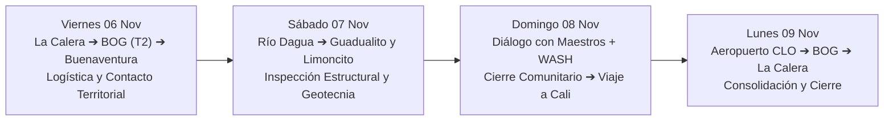

# Itinerario Operativo de Misión de Campo: Limoncito y Guadualito
**Evaluación Post-Sismo y Diagnóstico de Hábitat Resiliente (MDCP)**  
**Fechas:** Viernes 06 al Lunes 09 de Noviembre de 2026  
**Ruta General:** La Calera ➔ Bogotá (BOG/T2) ➔ Buenaventura (BUN) ➔ Río Dagua ➔ Cali (CLO) ➔ Bogotá (BOG/T1) ➔ La Calera  
**Responsable Técnico:** Ing. Jesús Durán Franco  

---

---

## Viernes 06 de Noviembre: Salida de La Calera y Llegada a Territorio

* **07:15 AM - 07:30 AM | Salida desde La Calera:**  
  * Salida en vehículo particular o servicio contratado hacia Bogotá vía Patios.
  * Anticipar tráfico matutino de viernes en la entrada por la Calle 84/Circunvalar y cruce hacia el occidente por la Calle 26 o Av. La Esperanza.
  * Tiempo estimado de traslado: 1 hora 45 min a 2 horas.

* **09:45 AM | Llegada al Aeropuerto El Dorado - Terminal 2 (Puente Aéreo):**  
  * **Cumplimiento de la meta de 3 horas antes** de la salida del vuelo (12:46 PM).
  * Satena opera sus vuelos regionales desde la **Terminal 2 (antiguo Puente Aéreo)**.

* **09:45 AM - 11:30 AM | Check-in y Actividades Previas al Vuelo:**  
  * Presentación en mostradores de Satena, facturación de equipaje en bodega (máximo 15 kg con herramientas e instrumental de campo).
  * Inspección de seguridad con equipaje de mano (máximo 5 kg de artículo personal).
  * Desayuno / café en sala y revisión de los paquetes de formatos de inspección impresos.

* **12:00 PM | Sala de Abordaje:**  
  * Llamado a embarque del vuelo Satena 9R 8725.

* **12:46 PM - 02:01 PM | Vuelo Bogotá (BOG) ➔ Buenaventura (BUN):**  
  * Vuelo en avión regional (ATR) sobrevolando la Cordillera Central y Occidental hasta el litoral.
  * Aterrizaje en el Aeropuerto Gerardo Tobar López de Buenaventura a las 02:01 PM.

* **02:15 PM - 03:00 PM | Reclamo de Equipaje y Encuentro Local:**  
  * Reclamo de la maleta de bodega con instrumental.
  * Encuentro con conductor o contacto local previamente coordinado en la terminal.

* **03:00 PM - 05:30 PM | Logística Crítica y Suministros en Buenaventura:**  
  * Compra de insumos esenciales de campo en Buenaventura: botellones de agua potable sellada (20 L o galones), sueros orales, bolsas plásticas reforzadas tipo consorcio/dry-bags adicionales, repelente y combustible para la lancha comunitaria.
  * Llamada o encuentro presencial con el Representante Legal o delegado del Consejo Comunitario de Guadualito para reconfirmar la hora y muelle de zarpe del sábado en la mañana.
  * Traslado al punto de pernoctada (hotel en Buenaventura o posada en Zacarías).

* **06:30 PM - 08:30 PM | Planificación Nocturna y Cena:**  
  * Cena ligera en Buenaventura o Zacarías.
  * Verificación de la **tabla de mareas** para la mañana del sábado.
  * Empaque impermeable en *dry-bags* de las libretas, formatos impresos, cámaras y herramientas que van al bote. Descanso temprano.

---

## Sábado 07 de Noviembre: Jornada Intensiva de Campo (Guadualito y Limoncito)

* **06:30 AM - 07:15 AM | Desayuno y Alistamiento:**  
  * Desayuno calórico, hidratación previa, aplicación de bloqueador y repelente.
  * Verificación de calzado (botas pantaneras de caña alta) y chaleco salvavidas.

* **07:30 AM - 08:15 AM | Embarque Fluvial en Río Dagua:**  
  * Salida desde el punto de embarque fluvial (Zacarías o muelle local) en lancha/potrillo con el motorista y líder asignado del Consejo Comunitario.
  * Navegación por el río Dagua hacia aguas abajo.

* **08:30 AM - 09:30 AM | Llegada y Asamblea Comunitaria (Guadualito):**  
  * Desembarque en el caserío central de Guadualito.
  * Saludo formal a la Junta del Consejo Comunitario, docentes y familias en la caseta comunitaria o escuela.
  * Diálogo de apertura: Explicar el propósito técnico y neutral de la visita (evaluación de ingeniería civil y hábitat resiliente) y escuchar relatos comunitarios sobre el sismo de 2026.

* **09:30 AM - 01:00 PM | Recorrido de Inspección Técnica Bloque 1 (Guadualito):**  
  * **Geotecnia y licuación:** Sondeo manual con varilla (tientón) y pala para verificar espesor de fango aluvial; inspección de grietas en suelo y orillas.
  * **Evaluación estructural palafítica:** Inspección vivienda por vivienda de las casas colapsadas vs. las que resistieron; medición con nivel de desplomes en pilotes, registro de fallas por pudrición basal en la interfase fango-aire y fallas en uniones clavadas.
  * **Llenado de fichas de campo** y registro fotográfico detallado georreferenciado.

* **01:00 PM - 02:00 PM | Almuerzo Comunitario:**  
  * Almuerzo tradicional preparado por las familias del Consejo Comunitario (coordinado con aporte solidario de la misión).

* **02:00 PM - 04:30 PM | Recorrido de Inspección Técnica Bloque 2 (Sector Limoncito):**  
  * Traslado en lancha o camino ribereño hacia el sector Limoncito (`3°49'02.0"N 77°01'56.0"W`).
  * Inspección de viviendas sobre el meandro fluvial.
  * **Hidrología y mareas:** Verificación y marcación de la cota máxima de inundación histórica en fustes de árboles y pilotes.
  * **Evaluación WASH:** Diagnóstico del estado de letrinas sobre estero y alternativas para sistemas elevados no contaminantes.

* **04:30 PM | Límite Estricto de Navegación por Luz Solar:**  
  * Zarpe de retorno fluvial hacia el embarcadero de Zacarías antes de que caiga el sol.

* **06:30 PM - 09:00 PM | Respaldo de Información y Cena:**  
  * Traslado a base de descanso.
  * **Descarga inmediata de fotos y notas de audio** al computador o almacenamiento offline para evitar pérdidas.
  * Consolidación de fichas de campo del día 1.

---

## Domingo 08 de Noviembre: Diálogo de Saberes Constructivos y Retorno a Cali

* **07:00 AM - 07:45 AM | Desayuno y Organización del Taller:**  
  * Revisión de láminas y bosquejos conceptuales del *Manual del Constructor Popular*.

* **08:15 AM - 11:30 AM | Encuentro Técnico con Maestros de Obra y Aserradores:**  
  * Sesión práctica con carpinteros de ribera y maestros locales:
    * Maderas locales: Identificación táctil y evaluación de probetas de Nato, Chanul, Cuángare, Mangle y Guadua.
    * Discusión técnica sobre uniones: Ventajas de la unión empernada con arandelas de presión vs. clavo liso, e importancia de las cruces de San Andrés ($X$) para frenar la oscilación sísmica.
    * Pruebas de vocabulario constructivo local para retroalimentar los textos del manual.

* **11:30 AM - 12:45 PM | Plan de Captación de Agua Lluvia y Refugio Progresivo:**  
  * Trazado esquemático en sitio de sistemas de canaletas con trampa de primer litro para abastecer los núcleos familiares más afectados.

* **12:45 PM - 01:45 PM | Almuerzo y Asamblea de Cierre:**  
  * Reunión de cierre con la directiva del Consejo Comunitario:
    * Devolución de hallazgos preliminares y recomendaciones urgentes de seguridad (apuntalamiento con pies de amigo de viviendas inestables).
    * Compromiso de envío de los resultados del manual adaptado al territorio.

* **02:15 PM | Salida Fluvial Definitiva:**  
  * Navegación de regreso al muelle de Zacarías / carretera principal.

* **03:30 PM - 07:00 PM | Traslado Terrestre Buenaventura ➔ Cali / Palmira:**  
  * Viaje por la Vía al Mar (Ruta 40) atravesando Dagua, Loboguerrero y subiendo a la Cordillera hacia el Valle del Cauca.
  * Tiempo estimado: 3 a 3.5 horas (considerando tráfico pesado de carga del puerto).
  * Llegada al hotel seleccionado en Cali o en las inmediaciones del Aeropuerto Alfonso Bonilla Aragón (Palmira).

* **07:30 PM - 09:30 PM | Cena, Alistamiento de Equipaje y Descanso:**  
  * Reorganización de maletas: En Avianca se cuenta con franquicia de hasta **23 kg en bodega** + **10 kg de maleta en cabina**, permitiendo empacar muestras secas de madera autorizadas, libretas y botas.

---

## Lunes 09 de Noviembre: Retorno Aéreo a Bogotá y Subida a La Calera

* **06:30 AM - 07:15 AM | Desayuno y Check-out:**  
  * Desayuno y salida del hotel hacia el terminal aéreo.

* **08:00 AM | Llegada al Aeropuerto Alfonso Bonilla Aragón (CLO):**  
  * **Cumplimiento estricto de las 3 horas de antelación** al vuelo de las 11:00 AM.

* **08:00 AM - 10:00 AM | Facturación de Equipaje y Filtros:**  
  * Entrega de maleta de 23 kg en módulos de Avianca.
  * Paso por filtros de seguridad y acceso a salas nacionales.
  * Tiempo productivo: Primer borrador del memorando técnico de visita de campo en computador o libreta.

* **10:20 AM | Abordaje:**  
  * Embarque en el vuelo Avianca AV 8522.

* **11:00 AM - 12:05 PM | Vuelo Cali (CLO) ➔ Bogotá (BOG):**  
  * Vuelo en Airbus A320 hacia Bogotá.
  * Aterrizaje en Terminal 1 de El Dorado a las 12:05 PM.

* **12:05 PM - 01:00 PM | Reclamo de Equipaje y Salida:**  
  * Reclamo de maleta en bandas de Terminal 1.
  * Encuentro con servicio de transporte terrestre hacia La Calera.

* **01:00 PM - 02:45 PM | Traslado Bogotá ➔ La Calera:**  
  * Trayecto Calle 26 ➔ Av. Circunvalar / Calle 84 ➔ Vía Patios ➔ La Calera.
  * Llegada al destino final y cierre exitoso de la misión.

