```mermaid
flowchart TD
    subgraph S1 [1. El Secreto de la Estabilidad]
        A1[Rectángulo sin diagonales: MECANISMO INESTABLE] -->|Empuje lateral de sismo o viento| A2[Deformación en paralelogramo y COLAPSO]
        B1[Rectángulo con Cruz de San Andrés: TRIÁNGULO INDEFORMABLE] -->|Empuje lateral| B2[Firmeza total y disipación de energía]
    end
    subgraph S2 [2. La Estructura Vertical de Madera]
        C1[Pilotes y Dados de Concreto] --> C2[Soleras y Vigas de Entrepiso]
        C2 --> C3[Pies Derechos / Columnas]
        C3 --> C4[Diagonales / Riostras de Esquina]
        C4 --> C5[Carreras y Vigas de Techo]
    end
    subgraph S3 [3. La Técnica de la Guadua NSR-10]
        D1[Selección de Guadua Madura 4-6 años] --> D2[Cortes: Boca de Pescado y Pico de Flauta]
        D2 --> D3[Perforación del canuto junto al nudo]
        D3 --> D4[Colocación de perno y varilla roscada]
        D4 --> D5[INYECCIÓN DE MORTERO 1:2: Núcleo macizo indeformable]
    end
```

# Manual del Constructor Popular Colombiano
## Capítulo Piloto: Módulo 3 — Estructuras en Madera y Guadua
### Subcapítulos 3.4 y 3.6: La Estructura que no se Cae: Pies Derechos, Diagonales de Arriostramiento y Ensambles Seguros en Bambú-Guadua

* **Formato de Publicación:** Tamaño Carta ($21.6 \times 27.9\text{ cm}$), alta legibilidad en blanco y negro.
* **Marco Técnico y Legal:** NSR-10 Título G (*Estructuras de Madera y Estructuras de Guadua*, Capítulos G.4, G.6, G.7 y G.12).
* **Territorio de Referencia:** Zonas ribereñas y costeras del Litoral Pacífico (comunidades de Limoncito y Guadualito, Buenaventura).

---

## Presentación del Subcapítulo

> **Palabra de Maestro:**  
> *"En nuestras tierras del Pacífico y de las riberas, la madera y la guadua son una bendición del monte: livianas, frescas, resistentes y aguantadoras. Pero una casa de madera no se cae por vieja ni porque la madera sea mala; se cae porque la armaron como una caja de fósforos floja, sin diagonales que la sostengan cuando la tierra se sacude o cuando el viento del mar empuja con rabia. En este capítulo vamos a aprender el secreto de los antiguos maestros y de los ingenieros de la norma NSR-10: cómo hacer para que la casa quede firme, cómo amarrar la guadua para que no se raje y cómo aislar los pilotes para que duren toda la vida."*

---



---

### Lámina Técnica 3.1: Estructura de Soporte — Palafito de Madera con Cruces de San Andrés


*Figura 3.1: Despiece axonométrico de la estructura palafítica en madera. Nótese el dado de concreto ciclópeo de 40x40 cm con pletina metálica en "U" para cortar la humedad capilar, las columnas (pies derechos), vigas maestras y el sistema de arriostramiento en Cruz de San Andrés.*

---

### Lámina Técnica 3.2: Detalle de Ensamble de Bambú-Guadua (NSR-10 Capítulo G.12)


*Figura 3.2: Corte en sección transversal del ensamble de guadua. Muestra el canuto relleno de mortero fluido 1:2 formando un núcleo macizo que abraza el perno pasante y las arandelas anchas junto al nudo natural, impidiendo que la guadua se raje.*

---

## 1. El Secreto de la Estabilidad: El Triángulo contra el Sismo

### 1.1. ¿Por qué se deforman las casas de madera? (El juego del rectángulo)
Haga usted mismo este experimento con cuatro listones de madera unidos en las cuatro esquinas con un solo clavo:

```
    ESTRUCTURA SIN DIAGONAL                    ESTRUCTURA CON DIAGONAL
    (Se deforma y se cae)                      (Triángulo rígido e indeformable)

         [Carrera de Techo]                         [Carrera de Techo]
         +-----------------+                        +-----------------+
         |                 |   EMPUJE DE            | \             / |   EMPUJE DE
         |                 |   VIENTO O             |   \         /   |   VIENTO O
         |                 |   TEMBLOR              |     \     /     |   TEMBLOR
         |                 |   ========>            |       \ /       |   ========>
         |                 |                        |       / \       |
         +-----------------+                        |     /     \     |
          [Solera de Piso]                          |   /         \   |
                                                    | /             \ |
       ¡SE APLASTA DE MEDIO LADO!                   +-----------------+
    (Las esquinas no aguantan el empuje)             [Solera de Piso]
                                                  ¡LAS CRUCES TRABAN EL MOVIMIENTO!
```

1. **El rectángulo es flexible por naturaleza:** Cuando cuatro palos forman un cuadro a 90°, las esquinas actúan como bisagras. Un empujón lateral de un sismo o un vendaval convierte el rectángulo en un paralelogramo inclinado hasta que los clavos se parten y el techo cae sobre la familia.
2. **El triángulo es la única figura geométrica indeformable:** Si a ese mismo rectángulo le clavamos un madero diagonal cruzado de esquina a esquina, la estructura queda amarrada. La diagonal entra a trabajar a tracción (tirando) o a compresión (empujando), impidiendo que las columnas se muevan.
3. **La Cruz de San Andrés:** Consiste en colocar dos diagonales cruzadas en forma de "X". Mientras una diagonal resiste el viento que viene de la izquierda, la otra diagonal resiste el empuje que viene de la derecha.

> [!CRITICAL]
> **¡PILAS CON ESTO, MAESTRO!**  
> Una casa palafítica en madera que no tenga al menos **dos paredes arriostradas con diagonales en el sentido largo y dos en el sentido corto** es una trampa mortal en un terremoto. Clavar tablillas horizontales de fachada NO es suficiente: la fuerza la resisten únicamente las **diagonales estructurales de madera maciza** o los forros estructurales continuos de madera contrachapada clavados cada 10 cm.

---

## 2. Los Componentes del Esqueleto Vertical (Maderas del Pacífico)

Para construir con seguridad en zonas como Buenaventura, la NSR-10 Título G exige seleccionar maderas de alta densidad y durabilidad natural (Grupos ES1, ES2 o ES3).

### 2.1. Nombres Locales, Identificación Táctil y Clasificación NSR-10

En el bosque pluvial del Pacífico conviven especies extraordinarias. Para la sesión de campo y la selección en obra, reconózcalas por sus características sensoriales y mecánicas:

| Grupo NSR-10 | Especie Local (Pacífico) | Identificación Táctil, Visual y Olfativa | Comportamiento Mecánico y Uso Recomendado |
| :--- | :--- | :--- | :--- |
| **ES1 (Muy Pesadas)** | **Nato** (*Mora megistosperma*) | Color rojizo a café chocolate oscuro; pesadísimo (se hunde en el agua); grano entrelazado; olor astringente a tanino. La navaja casi no penetra. | **El rey de los pilotes:** Inmune a la pudrición bajo fango saturado y agua salobre. Resiste la broma marina (*Teredo navalis*). Ideal para pilotes sumergidos y vigas maestras. |
| **ES1 (Muy Pesadas)** | **Mangle** (*Rhizophora mangle*) | Madera dura, fibra muy densa, color pardo rojizo. Difícil de clavar sin perforación guía. | Postes palafíticos, puntales de arriostramiento y soleras de piso expuestas a humedad salina continua. |
| **ES2 (Pesadas)** | **Chanul** (*Humiriastrum procerum*) | Color marrón amarillento a castaño; veteado fino; astillamiento elástico; peso alto pero manejable con serrucho y cepillo. | **Pies derechos (columnas) y diagonales de arriostramiento:** Gran rigidez a flexión y compresión paralela. No se pandea con facilidad ante el sismo. |
| **ES3 (Medias)** | **Cuángare** (*Otoba gracilipes*) | Color rosado claro a canela; madera liviana a media; textura suave al tacto; olor neutro; clava fácil sin rajarse. | Tabiquería divisoria, forro de paredes, cielo raso y entablado de piso interior (siempre protegido de la lluvia directa). |
| **ES3 (Medias)** | **Sajo / Otoba / Machare** | Tonos claros, poro abierto, secado relativamente rápido para el clima costero. | Correas de techo, divisiones ligeras y marcos de puertas y ventanas. |
| **NSR-10 G.12** | **Guadua** (*Guadua angustifolia*) | Tubo hueco con nudos cada 20–35 cm. Corteza verde brillante al cosechar y pajiza al secar. Fibras exteriores ultrarresistentes a tracción. | Columnas compuestas, soleras y diagonales ligeras (siempre con canuto inyectado con mortero en uniones empernadas). |

> [!TIP]
> **Prueba de Campo del Madero Sano (Sin instrumentos costosos):**  
> 1. **Prueba de la uña / navaja:** Si la uña marca con facilidad una hendidura profunda en el pilote, se trata de albura o madera blanda no apta para soporte estructural. El duramen de Nato o Chanul rechaza la hoja de corte.  
> 2. **Prueba del golpe:** Golpee el pilote con el mango del martillo; el Nato y el Chanul emiten un sonido seco y campante ("ting"), mientras que la madera picada o con pudrición interna suena opaca y hueca ("poc-poc").

### 2.2. Dimensiones Mínimas de Escuadría para Pies Derechos (Columnas)
* **Vivienda de 1 piso:** Columnas de mínimo $3" \times 4"$ ($7.5 \times 10\text{ cm}$) o rollizos de diámetro no menor a 10 cm.
* **Vivienda de 2 pisos (primer nivel):** Columnas de mínimo $4" \times 4"$ ($10 \times 10\text{ cm}$) o $4" \times 6"$ ($10 \times 15\text{ cm}$).
* **Separación entre columnas (intercolumnio):** Máximo cada **2.50 a 3.00 metros**. Entre columna y columna se colocan pies derechos secundarios de $2" \times 4"$ cada 50 o 60 cm para recibir el forro de las paredes.

---

## 3. Ensambles de Madera: Por qué NO Clavar "a Tope" Directo

Uno de los errores más peligrosos en la carpintería artesanal es unir dos maderos gruesos clavando un par de puntillas directas por fuera. Con el tiempo, el calor y la humedad resecan la madera, el viento sacude la cubierta y los clavos se aflojan como dientes sueltos.

```
       ERROR PELIGROSO:                          CONEXIÓN CORRECTA NSR-10:
    Clavado a tope directo                  Perno pasante con pletina y arandela

       [Carrera]                                   [Carrera]
       ====================                        ====================
          |      ^                                    |  [Pletina en T] |
          |      | Clavo trabajando                   |    o  o  o      |  Pernos pasantes
          |      | a extracción pura                  |  ---O----       |  con arandelas anchas
       +--+--+ (¡Se desclava solo!)                +--+--+   |          |
       |     |                                     |     |   O Perno    |
       | Pie |                                     | Pie |   | pasante  |
       | der |                                     | der |   o          |
       +-----+                                     +-----+              |
```

### 3.1. La Regla de los Pernos y las Arandelas (NSR-10 Capítulo G.6)
1. **Uso de Pernos Pasantes:** En las uniones entre pilotes, vigas maestras y columnas, se deben usar pernos de acero galvanizado o varillas roscadas de **3/8" o 1/2"** de diámetro.
2. **Arandelas Obligatorias:** Cada perno DEBE llevar una arandela ancha bajo la cabeza y otra bajo la tuerca. Si no se usa arandela, al apretar la tuerca o con el peso de la casa, el metal se incrusta en la madera y aplasta las fibras perdiendo la fuerza de apriete.
3. **Distancias Mínimas al Taladrar (para no rajar el palo):**
   * Del centro del hueco al extremo del madero: mínimo **7 veces el diámetro del perno** (para perno de 1/2", dejar mínimo 9 cm de borde libre).
   * Separación entre pernos de una misma hilera: mínimo **4 veces el diámetro** (mínimo 5 cm).
   * Distancia al borde lateral: mínimo **1.5 a 2 veces el diámetro**.

### 3.2. La Batalla Técnica: Clavo Liso vs. Perno con Arandela de Presión en Terremotos

Durante el sismo de 2026 en el litoral, la gran mayoría de casas palafíticas que colapsaron sufrieron la falla en sus ensambles clavados. La física de esta falla es muy clara:

| Criterio de Comparación | Unión Clavada Tradicional (Puntilla Lisa) | Unión Empernada NSR-10 (Perno + Arandela de Presión) |
| :--- | :--- | :--- |
| **Mecanismo de Agarre** | Fricción superficial microscópica entre el vástago liso y la fibra de madera. | Confinamiento mecánico pasante: la cabeza y la tuerca aprisionan todo el espesor de la madera. |
| **Comportamiento en Sismo (Carga Cíclica)** | En cada vaivén del terremoto (ida y vuelta), el clavo abre holgura en el agujero. Al cabo de 10 sacudidas, **la fricción cae a cero y el clavo se sale solo** (*falla por extracción*). | Indestructible al deslizamiento: el perno trabaja a **cizalladura pura** (corte transversal) y las arandelas impiden que los maderos se separen. |
| **Efecto de la Humedad del Pacífico** | La madera saturada de agua afloja la fibra; el clavo de hierro negro se oxida en 12 meses y pierde 50% de su sección resistente. | Con pernos galvanizados de 1/2", la corrosión es mínima y la madera puede hincharse y contraerse sin aflojarse. |
| **Rol de la Arandela de Presión (Grower)** | Inexistente. | Absorbe la contracción higroscópica de la madera (cuando se seca bajo el sol húmedo) manteniendo la tensión constante para que la tuerca no se desenrosque con el temblor. |

---

## 4. El Bambú-Guadua: La Regla de Oro del Canuto con Mortero (NSR-10 Capítulo G.12)

La guadua (*Guadua angustifolia Kunth*) es el acero vegetal de Colombia: resiste tensiones increíbles, es liviana y flexible. Sin embargo, su anatomía es la de un tubo hueco con fibras paralelas longitudinales: si usted le mete un perno a través de un canuto vacío y viene un sismo, el perno actúa como una cuña y **raja la guadua de arriba a abajo en dos mitades**.

Para evitar esto, la norma sismorresistente colombiana NSR-10 en su capítulo G.12 exige la **técnica del perno con mortero inyectado**:

```
                       PASO A PASO: LA UNIÓN INYECTADA NSR-10
                       
   Paso 1: Perforación             Paso 2: Ventanilla             Paso 3: Vaciado y Fraguado
   
         NUDO                            NUDO                            NUDO
      |========|                      |========|                      |========|
      |        |                      |  [==]  | <-- Ventanilla       | #######| <-- CANUTO
      |        |                      |        |     de inyección     | #######|     RELLENO CON
      |   (O)  | <-- Agujero de       |---(O)--| <-- Perno pasante    |---(O)--|     MORTERO 1:2
      |        |     perno 1/2"       |        |     de acero         | #######|     (Forma un tapón
      |        |                      |        |                      | #######|     sólido macizo)
      |========|                      |========|                      |========|
         NUDO                            NUDO                            NUDO
```

### Paso a Paso Constructivo:

1. **Selección del Canuto:**
   * La unión SIEMPRE debe realizarse en un canuto que tenga un **nudo natural inmediatamente adyacente** (a no más de 5 cm del perno). El nudo funciona como un zuncho natural que impide que el tubo se abra.
2. **Perforación Limpia:**
   * Con taladro y broca para madera afilada, perforar los dos lados del culmo con el diámetro exacto del perno (evitar quemar o astillar la guadua).
3. **Apertura de la Ventanilla de Inyección:**
   * En la parte superior del entrenudo, hacer una perforación de 1" o una ranura limpia por donde quepa la boquilla de embudo o manguera.
4. **Colocación del Perno y Sellado:**
   * Introducir el perno pasante de 3/8" o 1/2" con sus tuercas y arandelas anchas. Si el perno une dos guaduas, se colocan piezas de asiento o pletinas.
   * Colocar un poco de papel periódico o estopa en el fondo del canuto para taponar si el diafragma interno estuviera roto.
5. **Inyección del Mortero de Cemento:**
   * Preparar un mortero fluido (lechada densa) con **1 parte de cemento Portland por 2 partes de arena fina lavada** y agua suficiente para que escurra sin dejar grumos.
   * Rellenar completamente el canuto a través de la ventanilla golpeando suavemente la guadua con un mazo de caucho para que salgan las burbujas de aire.
6. **Curado:**
   * Al cabo de 48 horas, el mortero habrá fraguado formando un cilindro macizo de roca dentro de la guadua. El perno ahora se apoya contra una masa de concreto sólida: **¡la unión es indestructible ante fuerzas sísmicas!**

---

## 5. Cortes Tradicionales de Acople en Guadua

Para que los culmos encajen perfectamente entre sí sin perder resistencia, se aplican los cortes maestros tradicionales:

```
            CORTE "BOCA DE PESCADO"                       CORTE "PICO DE FLAUTA"
            (Unión perpendicular a 90°)                  (Unión en diagonal a 45°)
            
                   /========\                                   /========\
                  /          \                                 /        /
                 |    NUDO    |                               |  NUDO  /
                 \            /                                \      /
                  \          /                                  \    /
                 (            ) <-- Curva cóncava                \  /
                  \          /      que abraza el culmo           \/ <-- Bisel plano a 45°
                   \========/       de la columna                        para diagonales
```

* **Boca de Pescado (a 90°):** Se traza con una plantilla de cartón o un pedazo de tubo del mismo diámetro de la columna a recibir. Se vacía con serrucho de costilla o caladora. *Regla de oro:* El corte debe morir exactamente en el anillo del nudo.
* **Pico de Flauta (a 45°):** Se corta en bisel inclinado para apoyar diagonales de arriostramiento contra columnas o vigas. La base del pico debe apoyar firme contra un nudo del elemento vertical.

---

## 6. Aislamiento de Humedad en Palafitos (El Caso de Limoncito y Guadualito)

En los esteros y riberas del Pacífico colombiano, el suelo pasa gran parte del año saturado de agua por mareas (*pujas*) o crecientes fluviales. Si un poste de madera o un culmo de guadua se clava directo en el lodo:
* Se pudre en menos de 2 a 3 años por ataque de hongos xilófagos.
* Los microorganismos del fango destruyen la lignina en la zona de contacto aire-agua.

### La Solución Palafítica Sostenible: El Dado de Concreto Elevado

```
          DETALLE DE APOYO AISLADO DEL SUELO Y MAREAS (NSR-10 G.11)

                  [ COLUMNA DE MADERA O GUADUA ]
                               |  |
                               |  |
                 Perno pasante |==|
                 con arandelas |  |
                               |  |
                      +--------+  +--------+
                      | [Pletina en U de   |
                      |  acero galvanizado]|
                      +--------+--+--------+
                               |  |
                               |  | <-- LUZ LIBRE DE 5 CM (El agua escurre y no toca la base)
                ==============+====+==============
                |                                |
                |      DADO DE CONCRETO          | <-- Elevado mínimo 30 a 50 cm
                |         CICLÓPEO               |     por encima de la máxima marea
                |                                |
                |       (Varilla de anclaje      |
                |         embebida 30 cm)        |
                |                                |
                +--------------------------------+
                               |  |
                     [ SUELO FIRME / PILOTE ]
```

1. **Dado de Concreto Ciclópeo:** Se funde un dado de concreto (proporción 1:2:3 con 40% de piedra limpia) que sobresalga al menos **30 a 50 cm por encima de la cota de máxima inundación histórica**.
2. **Pletina Metálica en "U":** Antes de que el concreto endurezca, se deja embebida una pletina de acero de 3/16" en forma de "U" con una pata de anclaje de 30 cm con gancho.
3. **El Escurridor de 5 cm:** La columna de madera o guadua se monta sobre la pletina, asegurándose de que la base de madera quede separada **5 centímetros del concreto**. Así, el agua de lluvia o marea escurre libremente, el aire circula, y la madera se mantiene seca permanentemente.

### 6.1. Determinación de la Cota de Piso con Datos de Marea (Estación CP1-05 DIMAR)

Para no construir a ciegas, la altura del palafito en la cuenca del Río Dagua se calcula integrando los datos de la Red Hidrográfica de Referencia Vertical (Vértice CP1-05 TCBUEN / Bahía de Buenaventura):

* **Pleamar de Sicigia (*Puja* media - MHWS):** $+4.81\text{ m}$ sobre el datum LAT.
* **Marea Astronómica Máxima Extrema (HAT):** $+5.31\text{ m}$ sobre el datum LAT.
* **Rango de Marea Viva ($\text{MHWS} - \text{MLWS}$):** $4.56\text{ m}$ de oscilación de columna de agua.
* **Sobreelevación por Creciente del Río Dagua + Borde Libre:** En eventos de borrasca en la cordillera, el río aporta una sobreelevación de $0.50$ a $0.80\text{ m}$.
* **Fórmula Práctica para la Cota de Piso Terminado ($NPT_{min}$):**
  $$NPT_{min} = \text{Marca de Creciente Histórica en Árbol} + 0.60\text{ m (Borde Libre de Seguridad)}$$
  *(En Limoncito y Guadualito, esto equivale a una plataforma elevada entre **2.20 m y 2.80 m** respecto al lecho de fango).*

---

## 7. Lista de Chequeo del Maestro de Obra (Antes de Montar el Techo)

Antes de dar por terminada la estructura vertical y empezar a clavar el piso o la cubierta, revise punto por punto:

- [ ] **¿Están todas las columnas a plomo?** Verificar con plomada en las dos caras de cada pie derecho.
- [ ] **¿Hay Cruces de San Andrés en las esquinas?** Comprobar que en cada fachada haya al menos dos paneles triangulados con diagonales firmes.
- [ ] **¿Todos los pernos tienen arandela ancha en ambos lados?** Ningún perno debe estar directo sobre la madera sin arandela.
- [ ] **¿Se rellenaron con mortero todos los canutos de guadua donde pasan pernos?** Golpear suavemente con el cabo del martillo: debe sonar macizo como una piedra, nunca hueco.
- [ ] **¿Las bases de las columnas están despegadas del suelo?** Verificar que ninguna pieza de madera o guadua esté enterrada en tierra o en contacto directo con agua estancada.
- [ ] **¿Se inmunizó la madera contra el comején?** Aplicación de protector insecticida y fungicida en todas las caras y cortes antes del montaje.

---

## 8. Guía de Taller de Campo: Diálogo de Saberes con Carpinteros de Ribera

Esta sección contiene la metodología participativa para la sesión práctica de validación comunitaria en Guadualito y Limoncito:

### Dinámica 1: Reconocimiento Sensorial y Táctil de Maderas Locales
* **Materiales:** Retales de 30 cm de Nato, Chanul, Cuángare, Mangle y Guadua aportados por los maestros locales.
* **Ejercicio:**
  1. Pasar las muestras de mano en mano para sopesar la densidad relativa (el Nato se siente pesado como un lingote; el Cuángare es liviano).
  2. Hacer la incisión con navaja o clavo: comparar cómo el Nato rechaza la punta mientras el Cuángare cede con suavidad.
  3. Conversar con los viejos carpinteros sobre la "broma marina": registrar qué palos duran 20 años en agua salobre sin pudrirse.

### Dinámica 2: La Batalla de los Ensambles (Clavo Liso vs. Perno de 1/2")
* **Materiales:** Dos pares de listones de madera de 2"x4".
* **Demostración:**
  * Par A: Clavado con 2 puntillas lisas de 3".
  * Par B: Perforado y unido con 1 perno pasante de 1/2", dos arandelas planas y una arandela de presión.
  * Se pide a dos jóvenes de la comunidad que jalen y tuerzan ambas uniones con un barretón o palanca simulando la vibración del sismo. El Par A se descabeza o afloja en segundos; el Par B permanece inamovible. Esta demostración visual convence más que 50 horas de teoría.

### Dinámica 3: El Laboratorio del Triángulo y la Cruz de San Andrés
* **Materiales:** 4 listones delgados articulados en cuadro con un solo clavo en cada esquina, y 2 listones diagonales desmontables.
* **Demostración:**
  * Mostrar el cuadro sin diagonales: un niño puede deformarlo con un dedo hasta aplastarlo en el suelo (*paralelogramo inestable*).
  * Colocar una diagonal formando un triángulo: la estructura se bloquea en un sentido.
  * Colocar la segunda diagonal formando la Cruz de San Andrés ("X"): la estructura queda trabada en ambos sentidos, incapaz de colapsar ante empujes laterales de viento o terremoto.

### Dinámica 4: Mesa de Vocabulario y Lingüística Popular del Pacífico
Anotar en el cuaderno de campo las palabras exactas con las que los maestros locales nombran cada elemento para incorporarlas en las viñetas del manual:

| Término Técnico Formal (NSR-10) | Término Popular en el Interior | ¿Cómo lo llaman en Guadualito / Río Dagua? *(A registrar)* |
| :--- | :--- | :--- |
| **Pilote / Cimentación profunda** | Pilote, macho, cepa | __________________________________________ |
| **Columna / Pie derecho** | Pie derecho, columna, poste | __________________________________________ |
| **Viga maestra de entrepiso** | Viga corona, carguera | __________________________________________ |
| **Viguetas secundarias de piso** | Vigueta, alfajía, durmiente | __________________________________________ |
| **Diagonal de arriostramiento** | Riostra, pie de amigo, tornapunta | __________________________________________ |
| **Cruz de San Andrés** | Cruz en X, tijera, arriostre | __________________________________________ |
| **Solera o carrera superior** | Carrera, solera de amarre, solerón | __________________________________________ |
| **Ensamble a media madera** | Caja y espiga, traslape, empalme | __________________________________________ |

---

> [!TIP]
> **Próxima Lección (Módulo 3.7):**  
> En el siguiente subcapítulo aprenderemos a armar las cerchas ligeras de cubierta (*tipo Howe y Pendolón*), cómo calcular los aleros de 1 metro para que la lluvia no moje las paredes y cómo anclar las láminas de zinc con ganchos anti-huracán para que los vendavales del Pacífico no se lleven el techo.
