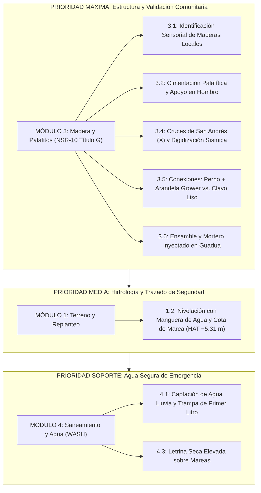

# Capítulos Prioritarios del Manual del Constructor Popular
## Misión Técnica de Campo: Limoncito y Guadualito (Buenaventura, Nov 2026)

---

### 1. Justificación y Alcance de la Priorización

La misión de campo del 6 al 9 de noviembre de 2026 en las comunidades de **Limoncito y Guadualito** (cuenca baja del río Dagua, Buenaventura) responde a la emergencia derivada del sismo de magnitud 7.4 y al proceso de validación comunitaria del *Manual del Constructor Popular Colombiano*.

Dado el tiempo limitado en territorio y las condiciones biofísicas extremas (pluviosidad >6.000 mm/año, suelos aluviales licuables, régimen mareal del Pacífico y aislamiento logístico), **no todos los módulos del manual tienen la misma urgencia**. 

Se priorizan los capítulos y subcapítulos que responden directamente a:
1. **Salvar vidas y estabilizar viviendas palafíticas habitadas** ante réplicas sísmicas.
2. **Generar un diálogo técnico horizontal con carpinteros de ribera y maestros locales** mediante pruebas sensoriales de probetas de madera y demostraciones de uniones.
3. **Asegurar agua potable y saneamiento inmediato** ante la turbiedad fluvial e inundaciones mareales.

---

### 2. Matriz de Contenidos Prioritarios para la Misión

| Prioridad | Módulo / Subcapítulo | Temas Clave a Trabajar en Sitio | Actividad Práctica con la Comunidad |
| :---: | :--- | :--- | :--- |
| **P1** | **3.1. Reconocimiento de Maderas del Pacífico** | Diferenciación de Nato (*Mora megistosperma*), Chanul, Cuángare, Mangle y Guadua. Duramen vs. Albura. Humedad de equilibrio >20%. | Ensayo de uña/navaja, prueba de sonido al golpe seco, peso relativo y verificación de ataques por broma marina (*Teredo navalis*). |
| **P1** | **3.2 y 3.5. Uniones Palafíticas y Apoyo en Hombro** | Falla por corte de clavos lisos vs. pernos pasantes de 1/2" con arandela de presión (Grower). Talla del rebaje/hombro en el pilote. | Demostración comparativa de descalce de clavo bajo vibración vs. perno con tuerca bloqueada. Inspección de hombros en casas existentes. |
| **P1** | **3.4. Arriostramiento Sísmico en Cruz de San Andrés ($X$)** | Por qué el cuadrilátero palafítico se colapsa lateralmente (mecanismo paralelogramo) y cómo el triángulo disipa la oscilación telúrica. | Trazo y colocación de una cruz de San Andrés real con carpinteros en un palafito afectado para apuntalamiento de emergencia. |
| **P1** | **3.6. Guadua Estructural e Inyección de Conexiones** | Selección de guadua madura (*jecha*). Cortes de ajuste: *boca de pescado* y *pico de flauta* junto a nudos. Inyección de mortero 1:2. | Taller de taladrado e inyección de canutos con mortero para evitar el rajado longitudinal del culmo. |
| **P2** | **1.2. Nivelación con Manguera y Cota de Marea** | Traslado de niveles en fango donde no entran niveles ópticos. Cota mínima de plataforma $\ge 2.20\text{ m}$ sobre marea viva (HAT +5.31 m). | Práctica comunitaria de purga y nivelación con manguera transparente de 3/8" entre pilotes de prueba. |
| **P3** | **4.1 y 4.3. Agua Lluvia (First Flush) y Saneamiento** | Desvío automático de primeras aguas sucias del techo. Prevención de letrinas anegadas por mareas. | Diseño participativo de un separador de lluvias con tubos PVC de 3" y revisión de letrinas secas elevadas. |

---

### 3. Capítulos Secundarios (Pospuestos para Fase 2)

Los siguientes módulos del *Plan General* **no se desarrollarán durante esta visita**:
*   **Módulo 2 (Mampostería Confinada - Título E):** Inaplicable en los suelos aluviales, manglares y fangos de Limoncito y Guadualito. Construir con ladrillo en esta zona es letal por licuación de suelos y riesgo sísmico.
*   **Módulo 4.4 (Instalaciones Eléctricas RETIE):** Prioridad baja inmediata frente a la estabilidad estructural y agua segura.
*   **Módulo 5 (Presupuestos y Cómputos Detallados):** Se abordará tras consolidar las cantidades de madera y pernos requeridas en la fase de reconstrucción.

---

### 4. Entregables de Trabajo Técnico a Desarrollar de Inmediato

1. **Redacción técnica exhaustiva del Módulo 3** en `Manual/capitulo_piloto_madera_y_guadua.md`:
   - Incorporar fichas sensoriales de las 5 especies clave.
   - Detallar la física de uniones empernadas con arandela de presión (Grower) y el tallado de hombro de pilote.
   - Detallar la geometría, dimensionamiento y clavado de Cruces de San Andrés.
   - Consolidar las 4 dinámicas de taller práctico para la sesión comunitaria de carpinteros de ribera.
2. **Sincronización con el visor web HTML** (`Manual/capitulo_piloto.html` e `index.html`) para permitir la visualización y consulta offline en teléfonos y tablets durante la expedición.