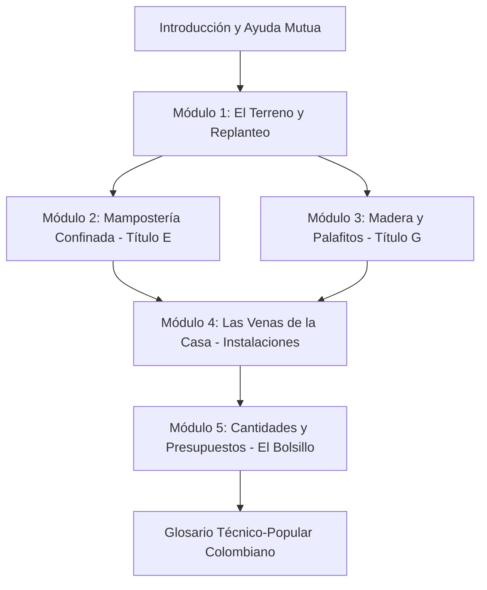

# Plan General: Manual del Constructor Popular Colombiano

## 1. Visión y Objetivos del Proyecto

**Objetivo Principal:** Crear la guía gráfica y técnica definitiva para la autoconstrucción, la ayuda mutua y los maestros de obra en Colombia, inspirada en la metodología visual y pedagógica del clásico *Manual del Constructor Popular* del Arq. Luis A. López R., adaptando y tropicalizando todos los requerimientos técnicos y legales a la realidad geográfica, social y normativa de Colombia.

**Público Objetivo:** Maestros de obra, oficiales de construcción, autoconstructores, líderes comunitarios, consejos comunitarios (Ley 70), cabildos indígenas, ONGs y fundaciones involucradas en mejoramiento de hábitat y reconstrucción ante desastres naturales.

**Marco Normativo Colombiano:**
*   **Ley 400 de 1997 y Decreto 926 de 2010 (NSR-10):**
    *   **NSR-10 Título E:** Casas de uno y dos pisos en mampostería confinada (cálculo simplificado de densidad sísmica de muros $L_{min}$, columnetas, vigas de amarre y losas).
    *   **NSR-10 Título G:** Estructuras de madera y estructuras de guadua (grupos estructurales ES1 a ES6, esfuerzos admisibles, uniones empernadas/clavadas, ensambles de guadua *angustifolia* y sistemas palafíticos).
*   **Reglamento Técnico de Instalaciones Eléctricas (RETIE):** Calibres de conductores AWG, protecciones termomagnéticas y sistemas de puesta a tierra.
*   **Reglamento Técnico del Sector de Agua Potable y Saneamiento Básico (RAS):** Sistemas descentralizados de saneamiento rural (trampas de grasa, pozos sépticos y campos de infiltración).

**Territorio Piloto de Validación:** Comunidades de **Limoncito y Guadualito** (Cuenca del Río Dagua / Bajo Calima, Buenaventura, Valle del Cauca). Este territorio representa el banco de prueba más exigente de Colombia por su extrema pluviosidad, alta sismicidad, suelo blando inundable y tradición en vivienda palafítica de madera.

---

## 2. Estrategia Visual y de Diseño

*   **Estilo de Ilustración Didáctico:** Isométricos y perspectivas axonométricas a línea limpia (*hidden line*), inspirados en el trazo de Luis A. López R. y modelados con precisión en herramientas 3D (Revit/SketchUp) para despieces constructivos claros.
*   **Alta Legibilidad en Fotocopia (B/N):** El manual debe ser 100% comprensible si se imprime en fotocopias de bajo costo o a blanco y negro en zonas rurales. Se usan tramas de puntos y líneas en lugar de gradientes de color.
*   **Voz y Lenguaje Local Colombiano:** Empleo del argot popular de obra en Colombia (*flejes, regatas, chuzar el concreto, formaletas, testeros, viga corona, columnetas, pie de amigo, cañuelas, pañete*), acompañado siempre del término técnico formal.
*   **Enfoque de Alertas ("¡Ojo con esto!"):** Viñetas de advertencia con personajes y símbolos visuales que destaquen los errores más frecuentes que causan colapsos en terremotos o pudrición prematura.
*   **Concepto de Vivienda Progresiva:** Cada prototipo y módulo enseña a planificar el crecimiento de la casa desde el "núcleo básico" (un ambiente multiuso, cocina y baño completo) hacia ampliaciones futuras sin debilitar la estructura original.

---

## 3. Matriz de Referencias Técnicas Base

El desarrollo de este manual se fundamenta en el análisis de la literatura técnica disponible en la carpeta de [Referencias](file:///g:/My%20Drive/MDCP/References/):

1.  [`manual-del-constructor-popular.md`](file:///g:/My%20Drive/MDCP/References/manual-del-constructor-popular.md): Referencia pedagógica original, urbanismo popular, viñetas de albañilería y vivienda progresiva.
2.  [`NSR-10-Titulo-G.md`](file:///g:/My%20Drive/MDCP/References/NSR-10-Titulo-G.md): Norma legal colombiana de madera y guadua, uniones, esfuerzos y diseño sismorresistente.
3.  [`5.-Manual-para-maestros-de-obra...md`](file:///g:/My%20Drive/MDCP/References/5.-Manual-para-maestros-de-obra-Gu%C3%ADa-para-construcci%C3%B3n-de-vivienda-tradicional-de-uno-y-dos-pisos.md): Guía de Argos para mampostería confinada según Título E, cuidados del concreto y armaduras.
4.  [`CartillaProsofi1...md`](file:///g:/My%20Drive/MDCP/References/CartillaProsofi1%20Cartilla%20de%20Autoconstrucci%C3%B3n%20para%20la%20vivienda%20de%20Uno%20o%20Dos%20Pisos.md): Guía de la Universidad Javeriana / PROSOFI; fórmula legal de densidad de muros $L_{min}$ y trámites de curaduría.
5.  [`Manual_del_Constructor_CEMEX.md`](file:///g:/My%20Drive/MDCP/References/Manual_del_Constructor_CEMEX.md): Tablas volumétricas de dosificación de concreto, pesos unitarios, instalaciones eléctricas e hidráulica.
6.  [`Manual de diseño para maderas del grupo andino.md`](file:///g:/My%20Drive/MDCP/References/Manual%20de%20dise%C3%B3o%20para%20maderas%20del%20grupo%20andino.md): Obra madre del PADT-REFORT; detalles constructivos de protección por diseño, palafitos, cerchas y uniones.
7.  [`agua-instalaciones1.md`](file:///g:/My%20Drive/MDCP/References/agua-instalaciones1.md): Manual isométrico hidrosanitario del Arq. Luis López R.; pozos sépticos, trampas de grasa y ventilación cloacal.
8.  [`20261015 Contexto Limoncito y Guadualito.md`](file:///g:/My%20Drive/MDCP/References/20261015%20Contexto%20Limoncito%20y%20Guadualito.md): Diagnóstico territorial y social de la comunidad piloto del Pacífico colombiano.
9.  [`Manuales Colombia.md`](file:///g:/My%20Drive/MDCP/References/Manuales%20Colombia.md): Catálogo de fuentes digitales e índices institucionales complementarios.

---

## 4. Índice General Detallado del Manual

### Introducción General
*   ¿Para qué sirve este manual y cómo usarlo en familia y en mingas?
*   El sismo en Colombia: ¿Por qué tiembla en nuestro país y por qué colapsan las casas mal construidas?
*   Seguridad y salud básica en la obra: protección ocular, uso de casco, manejo manual de cargas (no más de 25 kg por persona) y primeros auxilios.

---

### MÓDULO 1: El Terreno y los Primeros Pasos
*   **1.1. Conociendo el Suelo:**
    *   Suelo firme vs. suelo blando o relleno.
    *   Prueba casera de la botella para identificar arena, limo y arcilla.
    *   Retiro de la capa vegetal (descapote de 20 a 30 cm) y solado de limpieza.
*   **1.2. Nivelación y Replanteo:**
    *   Paso a paso de la nivelación con manguera de agua transparente (purga de burbujas).
    *   Trazado de escuadras perfectas con el triángulo **3-4-5** (Teorema de Pitágoras).
    *   Colocación de caballetes de madera, plomadas y piolas para fijar los ejes de la casa.
*   **1.3. ¿Ladrillo o Madera? Cómo elegir según región, clima y presupuesto:**
    *   Mampostería confinada: ideal para terrenos planos, secos y donde haya fácil acceso a ladrillo y cemento.
    *   Madera y palafitos: la opción más económica, segura y térmica para terrenos inundables, laderas o zonas costeras y ribereñas (Pacífico, Amazonía).

---

### MÓDULO 2: Construcción en Mampostería Confinada (NSR-10 Título E)
*   **2.1. Cimientos y Preparación del Concreto:**
    *   Zanjas de cimentación y concreto ciclópeo (proporción 1:2:3 con 40% de piedra bola limpia).
    *   Viga de cimentación / riostra ($30 \times 30$ cm o $25 \times 20$ cm): 4 varillas de 3/8" o 1/2" y flejes de 1/4".
    *   Dosificación manual en obra con cajón de madera ($30 \times 30 \times 30$ cm) y balde de 20 litros.
    *   El "chuzado" correcto con varilla para evitar hormigueros y coqueras.
*   **2.2. Muros de Carga y Densidad Sísmica:**
    *   Comprobación sencilla de la cantidad de muros en cada dirección: regla de la fórmula $L_{min} = (M_o \cdot A_p) / t$.
    *   Ladrillos tolete y bloques de arcilla de perforación horizontal (ladrillo farol): cómo pegarlos y reforzarlos.
    *   Mortero de pega 1:4 con cal hidratada; espesor de junta de 1.0 a 1.5 cm; colocación trabada a media pieza.
*   **2.3. Elementos de Confinamiento (El secreto de la sismorresistencia):**
    *   Columnetas de amarre (sección mínima $200\text{ cm}^2$): primero se pega el muro dentado y luego se vacía la columneta.
    *   Vigas de corona y amarre superior a nivel de entrepiso y cubierta.
    *   Cintas de amarre en antepechos de ventanas y dinteles de puertas.
    *   Confinamiento obligatorio del tímpano o culata triangular inclinada para evitar que caiga a la calle.
*   **2.4. Losas de Entrepiso y Cubiertas:**
    *   Losa maciza (mínimo 10 cm con doble malla) vs. losa aligerada con casetón de guadua o bloque (mínimo 20 cm).
    *   Vigas de remate y anclaje de cubiertas livianas de zinc o fibrocemento.
*   **2.5. Curado del Concreto:**
    *   Mojado continuo durante 7 días ininterrumpidos: la regla para no perder el 30% de resistencia.

---

### MÓDULO 3: Construcción en Madera y Palafitos (NSR-10 Título G)
*(Especial para el Litoral Pacífico, Amazonía y Zonas Inundables)*
*   **3.1. La Madera y la Durabilidad por Diseño:**
    *   Selección de especies según grupos estructurales colombianos (ES1 y ES2: Nato, Chanul, Roble, Guayacán).
    *   Secado al aire libre y contenido de humedad admisible.
    *   Inmunización tradicional y ecológica contra comején, termitas y hongos de pudrición.
*   **3.2. Cimentación Palafítica:**
    *   Pilotes de madera tratada hincados o dados de concreto aislados.
    *   Detalle anti-pudrición: pletina metálica en "U" con perno pasante que despega la columna 5 cm del concreto para evitar la humedad por capilaridad.
*   **3.3. El Entramado de Piso:**
    *   Vigas maestras, soleras y viguetas: cómo calcular la separación (40 a 50 cm) para que el piso no vibre ni "rebote".
    *   Entablado de madera machihembrada o entablado simple.
*   **3.4. Estructura Vertical y Sismorresistencia:**
    *   Pies derechos (columnas) continuos y carreras superiores.
    *   **El arriostramiento en Cruz de San Andrés:** Por qué una estructura sin diagonales se derrumba lateralmente y cómo clavar diagonales en las esquinas.
*   **3.5. Uniones y Conexiones Seguras:**
    *   Por qué no se debe confiar únicamente en clavos directos a tope.
    *   Uniones con pernos pasantes de 3/8" y 1/2" con arandelas anchas.
    *   Cortes y ensambles de carpintería tradicional (media madera, espiga y caja).
*   **3.6. Estructuras con Bambú - Guadua (*Guadua angustifolia Kunth*):**
    *   Selección de guaduas maduras (4 a 6 años) y corte en luna menguante.
    *   Cortes tradicionales: *boca de pescado* (a 90°) y *pico de flauta* (a 45°), siempre pegados a un nudo.
    *   **Unión con inyección de mortero:** Taladrado, colocación del perno y llenado del canuto con mortero 1:2 para impedir el rajado longitudinal del bambú.
*   **3.7. Techos Tropicales y Resistencia a Vientos Fuertes:**
    *   Cerchas ligeras de madera (tipo Howe y Pendolón).
    *   Aleros anchos (80 cm a 1.20 m) para proteger las paredes de la lluvia batiente.
    *   Anclajes metálicos anti-huracán entre cerchas, correas y láminas de cubierta.

---

### MÓDULO 4: Las Venas de la Casa (Instalaciones Básicas)
*   **4.1. Agua Potable y Captación de Lluvia:**
    *   Sistemas de captación de agua lluvia en cubierta: canaletas de PVC o zinc, filtro desarenador y desvío de las primeras aguas sucias (*first flush*).
    *   Trazado de tuberías de PVC presión (1/2" y 3/4"): recorridos ordenados, llaves de paso por zona y pruebas de presión antes de tapar.
    *   Tanque elevado y cálculo de gravedad para asegurar presión en la ducha.
*   **4.2. Desagües y Evacuación de Aguas Servidas:**
    *   Tubería de PVC sanitaria: pendientes obligatorias del 1.5% al 2% (¡ni más ni menos!).
    *   Accesorios a 45°: prohibición de codos o tes a 90° en líneas horizontales de desagüe.
    *   Cajas de inspección domiciliarias con fondo en cañuela.
    *   **La Ventilación Cloacal:** El tubo vertical que sube por encima del techo para evitar los malos olores y que los sifones se queden secos.
*   **4.3. Saneamiento Rural Descentralizado (Sin Alcantarillado):**
    *   **Trampa de Grasas:** Construcción y limpieza obligatoria para aguas de cocina y lavadero.
    *   **Tanque Séptico de Dos Cámaras:** Planos de construcción en ladrillo o concreto, dimensiones según número de habitantes y tuberías deflectoras en "T".
    *   **Campos de Percolación y Zanjas de Infiltración:** Distribución de tuberías perforadas sobre grava para infiltración en el terreno sin contaminar aguas subterráneas.
    *   Soluciones alternativas para zonas inundables: letrinas secas elevadas de compostaje o biodigestores plásticos herméticos.
*   **4.4. Electricidad Segura (RETIE Popular):**
    *   Acometida, caja de breakers y separación obligatoria de circuitos:
        *   Circuito 1: Iluminación (cable AWG #14, breaker 15A).
        *   Circuito 2: Tomacorrientes generales (cable AWG #12, breaker 20A).
        *   Circuito 3: Cargas especiales / cocina / ducha eléctrica (cable AWG #10, breaker 30A).
    *   Código de colores de cables: Fase (negro o rojo), Neutro (blanco), Tierra (verde o desnudo).
    *   Varilla de puesta a tierra (*copperweld*) obligatoria para salvar vidas ante cortocircuitos.

---

### MÓDULO 5: Cantidades y Presupuestos (El Bolsillo)
*   **5.1. Tablas Rápidas de Rendimiento:**
    *   ¿Cuántos sacos de cemento, viajes de arena y grava entran por metro cúbico de concreto?
    *   Cálculo de ladrillos tolete o bloques farol por metro cuadrado de muro (incluyendo 5% de desperdicio).
    *   Cálculo de metros de varilla y alambre negro por elemento estructural.
*   **5.2. Cubicación de Madera para Obra:**
    *   Fórmula del pie tablar ($PT = \frac{\text{ancho pulg} \times \text{espesor pulg} \times \text{largo pies}}{12}$).
    *   Conversión de metros lineales a piezas comerciales de madera.
*   **5.3. Hoja de Presupuesto Comunitario:**
    *   Plantilla paso a paso para cotizar una vivienda básica progresiva por etapas:
        *   Etapa 1: Cimientos y piso.
        *   Etapa 2: Muros y estructura.
        *   Etapa 3: Techo.
        *   Etapa 4: Baño y redes.

---

### Glosario del Constructor Popular Colombiano
*   Diccionario comparativo de términos técnicos formales vs. argot de obra colombiano:
    *   *Estribo* $\leftrightarrow$ **Fleje**
    *   *Ranura en muro* $\leftrightarrow$ **Regata**
    *   *Encofrado* $\leftrightarrow$ **Formaleta**
    *   *Pared de cierre de formaleta* $\leftrightarrow$ **Testero**
    *   *Compactación manual de concreto* $\leftrightarrow$ **Chuzado**
    *   *Revoque de mortero* $\leftrightarrow$ **Pañete o friso**
    *   *Puntal diagonal* $\leftrightarrow$ **Pie de amigo**
    *   *Viga de amarre superior* $\leftrightarrow$ **Viga corona**
    *   *Columna de confinamiento* $\leftrightarrow$ **Columneta**
    *   *Varilla corrugada de acero* $\leftrightarrow$ **Hierro**

---

## 5. Cronograma y Próximos Pasos de Ejecución

1.  **Aprobación del Plan General Actualizado:** Validación de la estructura temática y su articulación con los documentos técnicos de referencia.
2.  **Definición de Guías Gráficas y Formato Editorial:**
    *   **Formato Oficial:** **Tamaño Carta ($21.6 \times 27.9\text{ cm}$)**. Es el tamaño de papel estándar más común, económico y accesible en toda Colombia (fácil de imprimir y fotocopiar en cualquier papelería de barrio, alcaldía o vereda).
    *   **Orientación y Maquetación:** Puede plantearse vertical (para lectura tipo libro/cartilla estándar) u horizontal (tipo álbum técnico con amplio espacio para despieces isométricos).
    *   **Estilo Gráfico:** Tinta negra sobre blanco, grosores de línea contrastantes (*hidden line*), tramas mecánicas para texturas y viñetas de advertencia con alto impacto visual.
3.  **Desarrollo del Capítulo Piloto (SELECCIONADO: OPCIÓN B):**
    *   **Capítulo Piloto:** *Módulo 3 — Subcapítulos 3.4 y 3.6: Estructura Vertical de Madera, Arriostramientos (Cruces de San Andrés) y Ensambles Seguros en Bambú-Guadua (Enfoque Pacífico / Palafitos)*.
    *   Objetivo: Demostrar el tono pedagógico, el rigor técnico bajo NSR-10 Título G, y la conexión directa con las necesidades constructivas de las comunidades costeras y ribereñas.
4.  **Validación con la Comunidad Piloto:**
    *   Sesión de lectura y retroalimentación con maestros de obra y líderes de **Limoncito y Guadualito** (Buenaventura) para calibrar la claridad del mensaje, los dibujos y la pertinencia práctica antes de la redacción masiva del manual completo.