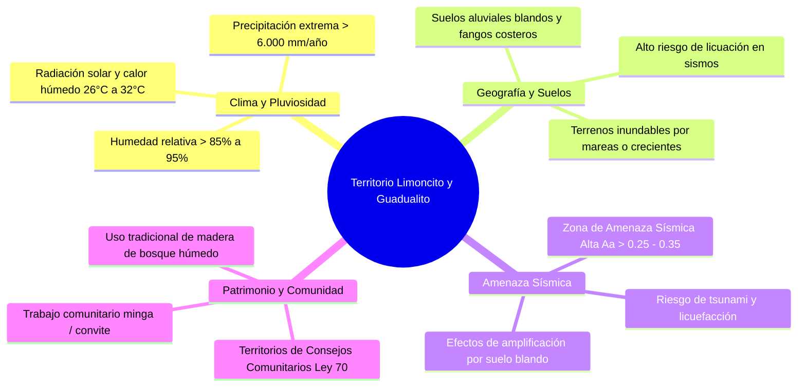

# Referencia Territorial y Contextual: Limoncito y Guadualito (Buenaventura)

- **Archivo Original / Enlace en la Nube:** [20261015 Contexto Limoncito y Guadualito.gdoc](file:///g:/My%20Drive/MDCP/References/20261015%20Contexto%20Limoncito%20y%20Guadualito.gdoc)
- **Documento en Google Drive:** [Abrir Documento en Google Docs](https://docs.google.com/document/d/1uBhLFbRW4muZ8yhXOF61UucLN2xDi74aePuno3LyWUg/edit)
- **ID de Google Docs:** `1uBhLFbRW4muZ8yhXOF61UucLN2xDi74aePuno3LyWUg`
- **Fecha de Creación / Contexto:** 15 de Octubre de 2026.
- **Ubicación Geográfica:** Comunidades y veredas de **Limoncito y Guadualito**, Cuenca de los ríos Dagua / Calima y zona de influencia de Buenaventura (Valle del Cauca, Litoral Pacífico colombiano).
- **Rol en el Proyecto:** Marco de referencia territorial real y caso piloto para la validación comunitaria del *Manual del Constructor Popular Colombiano*.

---

## 1. Justificación y Propósito del Documento

Este documento establece el **contexto socio-territorial y biofísico** que aterriza el manual técnico a una realidad viva en el territorio colombiano.

El *Manual del Constructor Popular* original nació en un contexto urbano/suburbano venezolano de valles intermontanos. Para que su adaptación a Colombia sea verdaderamente útil ("tropicalizada"), debe responder a las condiciones más exigentes del país: las comunidades rurales y ribereñas del Pacífico colombiano (Buenaventura), donde confluyen:
1. Máxima pluviosidad mundial y humedad constante.
2. Suelos aluviales blandos y terrenos inundables / mareales.
3. Máxima amenaza sísmica (cinturón de fuego del Pacífico / fosa de subducción de Nazca).
4. Tradición constructiva vernácula en madera y palafitos.
5. Inexistencia de redes públicas convencionales de acueducto y alcantarillado.

---

## 2. Diagnóstico Socio-Ambiental de Limoncito y Guadualito

### 2.1. Condiciones Climáticas y Geológicas
*   **Pluviosidad:** Entre 6.000 y 8.000 mm anuales de precipitación continua. La lluvia no es solo vertical sino "batiente" por vientos costeros.
*   **Humedad e Higroscopía:** Humedad de equilibrio de la madera permanentemente por encima del 20% - 24%. La madera nunca alcanza el secado normal del interior del país (12%), lo que exige aplicar los factores de corrección por humedad $C_M$ de la NSR-10 Título G.
*   **Régimen Hidrológico:** Fluctuaciones de marea (*pujas* y *quiebras*) y crecientes súbitas de los ríos que inundan las riberas. Las viviendas deben elevarse del suelo entre **1.5 y 3.0 metros** sobre pilotes.

### 2.2. Amenaza Sísmica (NSR-10)
*   Buenaventura y la costa del Valle del Cauca están catalogadas en **Zona de Amenaza Sísmica Alta** ($A_a \ge 0.25 - 0.35$).
*   Los suelos son estratos aluviales saturados de agua, lo que amplifica severamente las ondas sísmicas e induce el fenómeno de **licuación de suelos** (la tierra pierde su capacidad portante y se comporta como líquido durante un temblor).
*   En este entorno, una casa de mampostería pesada mal confinada es mortal; una **casa palafítica de madera liviana, flexible y bien arriostrada** es la solución más segura y resiliente para salvar vidas.

### 2.3. Organización Social y Recursos Locales
*   **Régimen Comunitario:** Territorios colectivos bajo Consejos Comunitarios de Comunidades Negras (Ley 70 de 1993). Las decisiones sobre el hábitat y las obras se toman en asamblea comunitaria.
*   **Trabajo Solidario:** Prácticas arraigadas de ayuda mutua como la **"minga"** o el **"cambio de mano"**, donde las familias se turnan para acarrear madera, clavar techos y levantar pilotes.
*   **Maderas Locales:** Aprovechamiento forestal tradicional de especies de la selva pluvial: Nato (*Mora megistosperma* - excelente para pilotes sumergidos en agua), Chanul, Cuángare, Otoba, Sajo, Mangle y Guadua.

---

## 3. Implicaciones Directas para el Manual del Constructor Popular

La realidad de Limoncito y Guadualito moldea los requerimientos específicos de los módulos del manual:

| Módulo del Manual | Desafío en Limoncito / Guadualito | Solución Técnica en el Manual |
| :--- | :--- | :--- |
| **Módulo 1: Terreno y Replanteo** | Suelo de fango, agua superficial y mareas | Nivelación con manguera referenciada a la cota de máxima creciente histórica; cimentación por pilotes hincados o dados de concreto aislados. |
| **Módulo 3: Madera y Palafitos** | Pudrición rápida de postes y vibración excesiva del piso | Empleo de madera de duramen denso (Nato/Chanul/Guayacán), aislamiento de base con dados de concreto elevados, diagonales en "X" (cruces de San Andrés) en los pilotes para resistir el sismo. |
| **Módulo 3: Techos y Vientos** | Vendavales y tormentas tropicales | Aleros amplios de 1.0 m con cielo falso ventilado; anclaje de correas con pletinas metálicas y clavos con arandela de caucho contra destechamiento. |
| **Módulo 4: Agua y Saneamiento** | Sin alcantarillado; nivel freático superficial | Captación y filtración de aguas lluvias (techo limpio + tanque con rebose); letrinas secas elevadas o biodigestores plásticos anaeróbicos elevados que no contaminen los esteros. |
| **Módulo 5: Cantidades y Presupuestos** | Transporte por lancha / bongo; costo elevado de materiales traídos de Buenaventura o Cali | Optimización del uso de madera aserrada local (cubicación en pies tablares) y minimización del desperdicio de cemento y varillas de acero. |

---

## 4. Validación Comunitaria del Manual (Paso 3 del Plan General)

Como establece el Plan General del Manual:
> *"Mostrar el piloto a un maestro de obra real o a líderes comunitarios (como los de Buenaventura) para asegurar que el mensaje es claro."*

Las comunidades de Limoncito y Guadualito serán el **banco de prueba piloto** para validar que las ilustraciones, el lenguaje (incorporando modismos locales del Pacífico) y las soluciones constructivas sean comprensibles y ejecutables por los propios constructores y artesanos locales.
