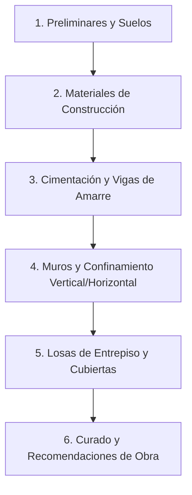

# Referencia Técnica: Manual para Maestros de Obra — Guía para Construcción de Vivienda Tradicional de Uno y Dos Pisos

- **Archivo Original:** [5.-Manual-para-maestros-de-obra-Guía-para-construcción-de-vivienda-tradicional-de-uno-y-dos-pisos.pdf](file:///g:/My%20Drive/MDCP/References/5.-Manual-para-maestros-de-obra-Gu%C3%ADa-para-construcci%C3%B3n-de-vivienda-tradicional-de-uno-y-dos-pisos.pdf)
- **Autor / Entidad Patrocinadora:** Argos (Cementos Argos S.A., Colombia).
- **Extensión:** 26 páginas en formato gráfico a color, con diagramas constructivos e isométricos de obra.
- **Marco Normativo:** Reglamento Colombiano de Construcción Sismo Resistente NSR-10 (especialmente Título E: Casas de uno y dos pisos en mampostería confinada).
- **Público Objetivo:** Maestros de obra, oficiales de albañilería, autoconstructores y técnicos de construcción en Colombia.

---

## 1. Propósito y Enfoque del Documento

Esta guía práctica elaborada por Argos traduce las exigencias legales y de ingeniería de la NSR-10 colombiana a un lenguaje directo de obra para la construcción sismorresistente de viviendas de uno y dos pisos. 

Su valor central radica en su **enfoque preventivo**: explica no solo cómo hacer las cosas correctamente, sino los errores constructivos más comunes cometidos por los albañiles empíricos (como ranurar vigas para pasar tubos, no curar el concreto o usar arena sucia) y cómo estos errores provocan el colapso durante un sismo.

---

## 2. Contenido Temático Estructurado

### 2.1. Preliminares y Estudio de Suelos (Sección 3)
*   **Identificación del estrato portante:** La cimentación debe apoyarse sobre suelo firme, retirando toda la capa vegetal o suelo orgánico (tierra negra).
*   **Profundidad de cimentación:** Si el estrato resistente se encuentra a más de 70 cm de profundidad, se deben ejecutar rellenos controlados en concreto ciclópeo o recebo compactado hasta lograr una profundidad mínima de 50 cm por debajo del nivel de piso terminado.
*   **Nivel freático y taludes:** Cuidado especial con la presencia de agua y la estabilidad de excavaciones colindantes.

### 2.2. Materiales de Construcción (Sección 4)
*   **Cemento:** Cemento gris y blanco de uso general (tipo Portland ordinario). Cuidado en el almacenamiento: estibas de madera elevadas 10 cm del piso, máximo 10 sacos apilados y protegidos con plástico de la humedad.
*   **Agregados:**
    *   *Arena:* Debe ser lavada, libre de limos, lodo, materia orgánica o sales marinas. Prueba empírica de pureza: frotar un puñado de arena en las manos; si mancha con tierra o barro, no es apta.
    *   *Grava o triturado:* Tamaño máximo recomendado entre 1/2" y 3/4" para elementos delgados como columnetas y losas.
    *   *Agua:* Debe ser potable; no usar aguas estancadas, jabonosas o con aceites.
*   **Acero de Refuerzo:**
    *   Barras corrugadas soldables o convencionales ($f_y = 420\text{ MPa}$ o Grado 60, identificadas con la letra "W" y número de designación en octavos de pulgada: #2 = 1/4", #3 = 3/8", #4 = 1/2").
    *   Ganchos estándar: dobleces a 90° con pata de al menos 10 cm o ganchos a 135° en estribos (flejes) para asegurar el amarre sísmico.
*   **Unidades de Mampostería:**
    *   Ladrillos de arcilla cocida (tolete o farol) y bloques de concreto.
    *   Los ladrillos deben ser humedecidos antes de colocarse para que no absorban el agua del mortero de pega. Los bloques de concreto, por el contrario, no deben saturarse de agua.

### 2.3. Cimentación (Sección 6.2)
*   **Concreto Ciclópeo:** Mezcla volumétrica de concreto simple (1 saco de cemento : 2 de arena : 3 de grava) combinada con **40% de piedra limpia de río (piedra bola)** de 15 a 25 cm de diámetro. Cada piedra debe quedar completamente envuelta en concreto (sin tocarse entre sí ni tocar las paredes de la zanja).
*   **Viga de Cimentación / Riostra:** 
    *   Sección típica mínima de 30x30 cm o según diseño estructural.
    *   Armadura longitudinal mínima: 4 varillas de 3/8" (#3) o 1/2" (#4).
    *   Estribos (flejes): varilla de 1/4" (#2) espaciados cada 20 cm en la zona central y cada 10 cm en los primeros 50 cm cerca de los nudos o cruces de muros.
    *   Recubrimiento mínimo de concreto sobre el acero: 5.0 cm a 7.5 cm en contacto con el terreno.

### 2.4. Mampostería Confinada (Sección 6.3)
*   **Mortero de Pega:** Proporción 1:3 o 1:4 (cemento : arena lavada). Se recomienda adicionar cal hidratada hasta en un 25% del volumen de cemento para mejorar la trabajabilidad y retención de agua.
*   **Espesor de juntas:** Entre 10 mm y 15 mm. El mortero debe cubrir uniformemente toda la superficie de apoyo y la llaga vertical.
*   **Traba de muros:** Los ladrillos deben trabarse a media pieza ("rompejunta"). Nunca hacer coincidir juntas verticales consecutivas.
*   **Confinamiento Monolítico (Regla de Oro):**
    *   **Primero se levanta el muro de mampostería con el dentado en los extremos**, y **luego se vacían las columnetas de amarre**. Esto garantiza la traba mecánica total entre el muro y la columna.
    *   Queda terminantemente prohibido vaciar primero los machones lisos y pegar los ladrillos después sin conectores de acero.

### 2.5. Losas de Entrepiso y Techos (Secciones 6.4 y 6.6)
*   **Forma y Simetría:** Las losas deben ser regulares (cuadradas o rectangulares) para actuar como diafragmas rígidos que distribuyan las fuerzas sísmicas.
*   **Losas Macizas:** Espesor mínimo de 10 a 12 cm, con malla electrosoldada o varillas cruzadas en ambas direcciones.
*   **Losas Aligeradas:** Espesor mínimo de 20 cm, compuestas por viguetas de concreto armado (nervios) cada 40 a 50 cm y elementos aligerantes (casetón de ladrillo farol, esterilla de guadua o poliestireno), cubiertas por una plaqueta de compresión de 5 cm de espesor con malla electrosoldada.
*   **Vigas de Corona (Amarre Superior):** Amarran el muro en la parte superior y reciben el apoyo de la losa o la cercha de cubierta.

### 2.6. Curado y Desencofrado (Sección 7)
*   **Curado obligatorio:** El concreto y los morteros deben mantenerse permanentemente húmedos durante un mínimo de **7 días continuos**. La falta de curado reduce hasta un 30% la resistencia final y causa fisuras por contracción plástica.
*   **Tiempos mínimos de desencofrado:**
    *   Laterales de vigas y columnetas: 24 a 48 horas.
    *   Fondos de vigas y losas (con puntales de seguridad): mínimo 14 a 21 días.

---

## 3. Advertencias Críticas de Obra Señaladas por Argos

1. **¡Cuidado con las regatas (ranuras para tuberías)!**
   * Está **totalmente prohibido** ranurar vigas de amarre o columnetas para meter tuberías de desagüe de PVC de 3" o 4". La tubería rompe el acero y la sección de concreto, anulando la sismorresistencia.
   * Las bajantes y tuberías deben pasar por ductos independientes o en muros no estructurales.
2. **¡Cuidado con el exceso de agua en la mezcla!**
   * Una mezcla aguada es más fácil de palear, pero pierde drásticamente su resistencia a la compresión. El concreto debe ser pastoso y chuzarse con varilla para que llene los encofrados sin dejar "hormigueros".

---

## 4. Relevancia Directa para el *Manual del Constructor Popular Colombiano*

Este documento de Argos es el puente directo para tropicalizar el original venezolano a la realidad colombiana:
*   Aporta las **terminologías de obra oficiales en Colombia** (vigas de amarre, columnetas, flejes, chuzado, formaletas, regatas).
*   Proporciona las **dimensiones mínimas de elementos de mampostería confinada** validadas por la industria cementera colombiana bajo NSR-10 Título E.
*   Sirve de base para el **Módulo 2 (Construcción en Mampostería Confinada)** del plan general.
