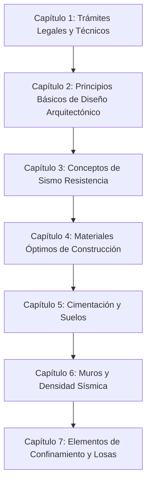

# Referencia Técnica: Cartilla de Autoconstrucción para la Vivienda de Uno o Dos Pisos (PROSOFI - PUJ)

- **Archivo Original:** [CartillaProsofi1 Cartilla de Autoconstrucción para la vivienda de Uno o Dos Pisos.pdf](file:///g:/My%20Drive/MDCP/References/CartillaProsofi1%20Cartilla%20de%20Autoconstrucci%C3%B3n%20para%20la%20vivienda%20de%20Uno%20o%20Dos%20Pisos.pdf)
- **Autores / Institución:** Programa Social PROSOFI — Facultad de Ingeniería y Facultad de Arquitectura, Pontificia Universidad Javeriana (Bogotá D.C., Colombia). Líder de Proyecto: Ing. José Antonio Magallón Gudiño.
- **Año y Edición:** Primera Versión, Diciembre 2013. Proyecto validado en campo con la comunidad del sector Bolonia, localidad de Usme, Bogotá.
- **Extensión:** 39 páginas estructuradas pedagógicamente con planos, esquemas en 3D y tablas de cálculo simplificado.
- **Marco Normativo:** Reglamento Colombiano de Construcción Sismo Resistente NSR-10 (Tomo 3, Título E: Casas de uno y dos pisos).

---

## 1. Propósito y Valor Metodológico

Esta cartilla representa uno de los mejores esfuerzos académicos y sociales en Colombia para traducir el **Título E de la NSR-10** a una herramienta metodológica de autoconstrucción comunitaria.

A diferencia de manuales comerciales, este documento:
1. **Integra los trámites legales y urbanísticos:** Explica cómo gestionar licencias de construcción, trámites ante Curadurías Urbanas y conexiones legales a acueducto y alcantarillado.
2. **Aborda el diseño arquitectónico y la habitabilidad:** Enseña a las familias a zonificar su vivienda (zona social, íntima y de servicios) y a prever el crecimiento progresivo sin comprometer la estructura futura.
3. **Ofrece el método simplificado de cálculo de muros de la NSR-10:** Incluye la fórmula legal para calcular la cantidad mínima de muros estructurales que debe tener una casa en cada dirección para no derrumbarse ante un terremoto.
4. **Incorpora ladrillos de perforación horizontal:** Regula el uso del bloque hueco (ladrillo farol), el material más común y a menudo mal utilizado en los barrios populares colombianos.

---

## 2. Estructura Temática de la Cartilla

### 2.1. Requisitos Legales y Trámites Previos (Capítulo 1)
*   **Modalidades de Licencia de Construcción:**
    *   *Obra nueva:* En lotes no construidos.
    *   *Ampliación:* Adición de área construida (ej. segundo piso).
    *   *Modificación:* Variación de diseño interno sin aumentar área.
    *   *Reforzamiento estructural:* Intervención para adecuar la edificación a niveles seguros de sismorresistencia.
    *   *Reconocimiento de edificación:* Legalización de viviendas ya existentes construidas sin licencia.
*   **Servicios Públicos (Acueducto y Alcantarillado):** Requisitos para independización de acometidas y solicitudes de servicio provisional de obra.

### 2.2. Diseño Arquitectónico y Habitabilidad (Capítulo 2)
*   **Zonificación funcional:**
    *   *Zona Social:* Sala, comedor, circulaciones principales.
    *   *Zona de Servicios:* Cocina, patio de ropas, baño social.
    *   *Zona Íntima:* Alcobas, baño privado.
*   **Desarrollo Progresivo:** Prever la ubicación definitiva de las escaleras desde la primera etapa para evitar tener que romper losas o demoler muros estructurales en el futuro.
*   **Ventilación e iluminación:** Ninguna habitación habitable puede quedar ciega (sin ventana directa a la calle o a patio interior). Área mínima de ventana: 10% a 15% del área del piso.

### 2.3. Principios de Sismorresistencia (Capítulo 3)
*   **Forma Regular y Simetría:** Evitar plantas en "L", "T" o "U" asimétricas que generen torsión durante el sismo. Si la forma es irregular, debe dividirse en módulos rectangulares independientes con juntas sísmicas de 2.5 a 5.0 cm.
*   **Continuidad Vertical:** Los muros del segundo piso deben nacer exactamente sobre los muros del primer piso. No apoyar muros de carga sobre losas en voladizo o en mitad de un vano sin viga de soporte.
*   **Diafragma Rígido:** La losa de entrepiso y la cubierta deben amarrar todas las paredes perimetrales para que la casa vibre como una sola caja monolítica.

### 2.4. Materiales de Obra (Capítulo 4)
*   **Agregados:** Grava graduada de 1/2" a 3/4" y arena limpia. Advertencia contra arenas de río contaminadas con limo.
*   **Concretos:** Resistencia mínima de 17.5 MPa ($210\text{ kg/cm}^2$ o 3000 PSI) para elementos estructurales (vigas y columnas).
*   **Concreto Ciclópeo:** 60% concreto simple + 40% piedra bola limpia de 15 a 20 cm.
*   **Acero:** Barras corrugadas con límite de fluencia $f_y = 420\text{ MPa}$ (60.000 PSI).
*   **Ladrillos de perforación horizontal:** Normas para el uso seguro de ladrillos farol en mampostería confinada (espesor de tabique exterior no menor a 15 mm).

### 2.5. Cimentación (Capítulo 5)
*   **Nivel de cimentación:** Retiro completo de la capa vegetal (mínimo 20 a 30 cm de descapote).
*   **Zanja y Mejoramiento:** En suelos blandos, excavar hasta suelo firme; conformar solado de limpieza en concreto pobre (espesor 5 cm) para evitar que el lodo contamine el acero de refuerzo.
*   **Viga de cimentación:** Sección mínima según NSR-10: ancho mínimo 20 cm, altura mínima 20 cm para casas de 1 piso, y $30 \times 30$ cm en casas de 2 pisos, armada con 4 varillas de 3/8" o 1/2" y estribos de 1/4" cada 10 cm en extremos y cada 20 cm al centro.

### 2.6. Muros Estructurales y Densidad Sísmica (Capítulo 6)
Uno de los aportes más valiosos de esta cartilla es la explicación de la fórmula de **densidad mínima de muros de la NSR-10 Título E**:

$$L_{min} = \frac{M_o \cdot A_p}{t}$$

Donde:
*   $L_{min}$: Longitud mínima requerida de muros confinados en cada una de las dos direcciones ortogonales (X e Y), en metros lineales.
*   $M_o$: Coeficiente sísmico de la edificación (determinado por la aceleración pico efectiva $A_a$ de la zona sísmica y el número de pisos, según la Tabla E.3.6-1 de la NSR-10).
*   $A_p$: Área total de la cubierta o entrepiso que descarga sobre los muros ($m^2$).
*   $t$: Espesor del muro en milímetros (mm).

#### Coeficiente $M_o$ (NSR-10 Tabla E.3.6-1):
| Zona de Amenaza Sísmica | Aceleración $A_a$ | Casa de 1 Piso | Casa de 2 Pisos (Muro 1er Piso) | Casa de 2 Pisos (Muro 2do Piso) |
| :--- | :---: | :---: | :---: | :---: |
| **Baja** | $A_a \le 0.10$ | $16$ | $33$ | $16$ |
| **Intermedia** | $0.10 < A_a \le 0.20$ | $25$ | $50$ | $25$ |
| **Alta (ej. Buenaventura, Cali, Medellín, Bogotá)** | $A_a > 0.20$ | $33$ | $67$ | $33$ |

*Regla práctica de espesores:*
*   En casas de 1 piso en zona alta: espesor mínimo $10\text{ cm}$ (bloque No. 4 o tolete).
*   En casas de 2 pisos: espesor mínimo en 1er piso $12.5\text{ cm}$ (bloque No. 5).
*   Longitud libre máxima horizontal entre confinamientos: **no mayor a 35 veces el espesor efectivo del muro** (aprox. 3.5 a 4.0 metros).

### 2.7. Elementos de Confinamiento y Losas (Capítulo 7)
*   **Columnetas de amarre:** Área transversal mínima de $200\text{ cm}^2$ (ej. $10 \times 20$ cm o $12.5 \times 16$ cm).
*   **Vigas de amarre superior:** Ubicadas a nivel de entrepiso y enrase de cubierta. En remates de culatas o piñones inclinados, deben rematarse con vigas de corona inclinadas o cintas de amarre.
*   **Cintas de amarre en dinteles y antepechos:** 2 varillas de 3/8" con ganchos en "C" cada 15 cm para evitar grietas diagonales en las esquinas de ventanas y puertas.
*   **Tabla de losas macizas:** Espesor mínimo 10 cm para luces de hasta 3.0 m (varilla #3 cada 15 cm); espesor 12 cm para luces hasta 3.5 m.

---

## 3. Relevancia Directa para el *Manual del Constructor Popular Colombiano*

Esta cartilla de la Javeriana aporta elementos clave que deben adoptarse de inmediato:
1. **La fórmula de comprobación de muros:** Convertir la fórmula $L_{min} = \frac{M_o \cdot A_p}{t}$ en un ejercicio gráfico paso a paso para que cualquier maestro de obra calcule si la casa tiene suficientes muros o si le falta un muro en el sentido corto.
2. **El tratamiento de la culata inclinada del techo:** Los diagramas de PROSOFI que enseñan a confinar la culata triangular con una vigueta inclinada son esenciales para evitar que el tímpano de ladrillo se caiga hacia la calle en un terremoto.
3. **El enfoque social y legal:** Aportar el componente de licencias y urbanismo progresivo adaptado al marco legal colombiano.
