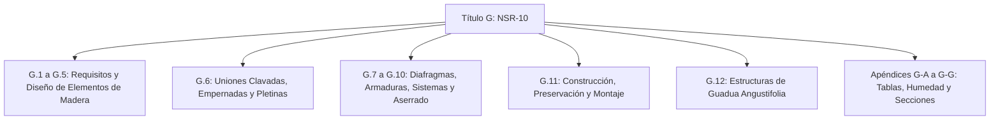

# Referencia Técnica: NSR-10 Título G — Estructuras de Madera y Estructuras de Guadua

- **Archivo Original:** [NSR-10-Titulo-G.pdf](file:///g:/My%20Drive/MDCP/References/NSR-10-Titulo-G.pdf)
- **Entidad Emisora:** Ministerio de Ambiente, Vivienda y Desarrollo Territorial — Comisión Asesora Permanente para el Régimen de Construcciones Sismo Resistentes (República de Colombia).
- **Marco Legal:** Ley 400 de 1997, Decreto 926 de 2010 (Reglamento Colombiano de Construcción Sismo Resistente NSR-10).
- **Extensión:** 168 páginas técnicas normativas, tablas de esfuerzos admisibles y apéndices de cálculo.
- **Enfoque Principal:** Requisitos obligatorios de diseño y construcción sismorresistente para edificaciones de madera aserrada, madera rolliza y bambú-guadua (*Guadua angustifolia Kunth*).

---

## 1. Visión General y Alcance del Título G

El Título G de la NSR-10 reglamenta el uso estructural de la madera y la guadua en el territorio colombiano. Es de cumplimiento obligatorio para cualquier edificación formal, comunitaria o de interés social en el país.

Su incorporación en el *Manual del Constructor Popular Colombiano* es fundamental para:
1. **Regiones del Litoral Pacífico, Amazonía, Orinoquía y riberas fluviales:** Zonas donde la madera y la guadua son los materiales predominantes por disponibilidad local, costo y tradición cultural.
2. **Construcción palafítica:** Viviendas elevadas sobre el agua o terrenos inundables con alta vulnerabilidad ante crecientes y sismos.
3. **Formalización técnica del saber tradicional:** Traducir los métodos empíricos de carpintería de ribera a especificaciones normativas seguras frente a terremotos y vientos huracanados.

---

## 2. Índice Temático del Título G

*   **Capítulo G.1: Requisitos Generales:** Glosario, definiciones, clasificación de la madera estructural y tolerancias de defectos (nudos, rajaduras, alabeos).
*   **Capítulo G.2: Bases para el Diseño Estructural:** Filosofía de esfuerzos admisibles ($F_i$), combinaciones de carga y coeficientes de modificación ($C_D, C_M, C_t, C_L, C_F$).
*   **Capítulo G.3: Diseño de Elementos Solicitados por Flexión:** Vigas, viguetas, deflexiones límites ($L/240$ a $L/360$), volcamiento lateral y longitud no arriostrada.
*   **Capítulo G.4: Diseño de Elementos Solicitados por Fuerza Axial:** Columnas, pies derechos, postes, clasificación por esbeltez ($\lambda = l_e / d$) en columnas cortas, intermedias y largas.
*   **Capítulo G.5: Flexión y Carga Axial Combinadas:** Ecuaciones de interacción para vigas-columnas.
*   **Capítulo G.6: Uniones:** Uniones clavadas, empernadas, tirafondos, pasadores y pletinas metálicas. Espaciamientos mínimos al borde, extremos y entre conectores.
*   **Capítulo G.7: Diafragmas Horizontales y Muros de Corte:** Entramados de piso y techo con capacidad para transmitir fuerzas sísmicas a los muros de cortante y arriostramientos en cruz de San Andrés.
*   **Capítulo G.8: Armaduras:** Cerchas ligeras para cubiertas, estabilidad lateral de cuerdas y nudos.
*   **Capítulo G.9: Sistemas Estructurales:** Tipologías de pórticos, entramados ligeros (*balloon/platform framing*), postes y vigas, y estructuras palafíticas.
*   **Capítulo G.10: Aserrado:** Dimensiones comerciales, nominales y reales (tolerancias por contracción).
*   **Capítulo G.11: Preparación, Fabricación, Construcción, Montaje y Mantenimiento:** Secado, protección por diseño, tratamientos químicos inmunizantes y preservación contra insectos y pudrición.
*   **Capítulo G.12: Estructuras de Guadua:** Requisitos de diseño y construcción con culmos de *Guadua angustifolia Kunth*.
*   **Apéndices G-A a G-G:** Determinación de esfuerzos admisibles, parámetros sísmicos, contracciones radiales y tangenciales, contenido de humedad de equilibrio por departamentos de Colombia, normas NTC e ICONTEC complementarias, y tablas de secciones comerciales.

---

## 3. Parámetros Técnicos Clave para el Constructor Popular

### 3.1. Grupos Estructurales de Madera en Colombia (Tabla G.2.2-1)
La norma clasifica las maderas colombianas según su densidad básica ($D_B$) y capacidad mecánica en seis grupos estructurales (ES1 a ES6), equivalentes a los antiguos Grupos A, B y C del Pacto Andino:

| Grupo Estructural | Densidad Básica ($g/cm^3$) | Flexión $F_b$ (MPa) | Compresión // $F_c$ (MPa) | Compresión $\perp$ $F_{cp}$ (MPa) | Cortante $F_v$ (MPa) | Módulo Elast. Promedio $E_{0.5}$ (MPa) |
| :--- | :---: | :---: | :---: | :---: | :---: | :---: |
| **ES1 (Muy Pesadas / A)** | $> 0.75$ | $21.0$ | $14.5$ | $4.0$ | $2.5$ | $13,000$ |
| **ES2 (Pesadas / A-B)** | $0.65 - 0.75$ | $18.0$ | $12.5$ | $3.2$ | $2.0$ | $11,500$ |
| **ES3 (Medias / B)** | $0.55 - 0.65$ | $15.0$ | $11.0$ | $2.5$ | $1.8$ | $10,000$ |
| **ES4 (Ligeras / B-C)** | $0.45 - 0.55$ | $12.0$ | $9.0$ | $1.8$ | $1.5$ | $9,000$ |
| **ES5 (Blandas / C)** | $0.35 - 0.45$ | $10.0$ | $8.0$ | $1.4$ | $1.2$ | $7,500$ |
| **ES6 (Muy Blandas)** | $< 0.35$ | $7.0$ | $6.0$ | $1.0$ | $0.9$ | $6,000$ |

*Nota práctica para obra:* Para elementos portantes (pilotes, columnas, soleras, vigas maestras) se debe exigir como mínimo maderas del grupo **ES1, ES2 o ES3** (como Chanul, Abarco, Algarrobo, Guayacán, Carreto, Choibá o Roble).

### 3.2. Contenido de Humedad y Secado (G.1.3.4 y G.11)
*   **Madera verde ($CH > 30\%$):** Pierde hasta el 10% de su dimensión en contracción tangencial al secarse al aire libre, lo que afloja clavos y tuercas.
*   **Condición seca de servicio:** La madera estructural debe instalarse con un contenido de humedad menor o igual al **19%** (en climas secos) o al equilibrio higroscópico local (hasta 22% en zonas costeras cálido-húmedas como Buenaventura y Chocó).

### 3.3. Uniones Estructurales (Capítulo G.6)
*   **Prohibición de clavar a tope directo en tracción:** Los clavos trabajando a extracción directa están prohibidos en empalmes estructurales principales.
*   **Espaciamientos mínimos para pernos pasantes:**
    *   Distancia al extremo cargado: mínimo $7 \times d$ (7 veces el diámetro del perno) para tracción paralela.
    *   Distancia entre pernos en la misma fila: mínimo $4 \times d$.
    *   Distancia al borde lateral: mínimo $1.5 \times d$ (o $4 \times d$ si la carga es perpendicular).
    *   Uso obligatorio de **arandelas anchas** bajo la cabeza y tuerca para evitar el aplastamiento de las fibras de madera al apretar.

---

## 4. Capítulo G.12: Estructuras de Guadua (*Guadua angustifolia*)

El Capítulo G.12 es pionero a nivel mundial en la normalización de la guadua como material sismorresistente. Puntos fundamentales para el manual:

1. **Selección del culmo:**
   - Edad de cosecha: entre 4 y 6 años (culmo "maduro" o "hecho"). No utilizar guadua biche (verde) ni sobremadura (seca o rajada).
   - Diámetro exterior recomendado: entre 9 y 12 cm, con espesor de pared mínimo de 10 a 12 mm.
2. **Cortes de acople:**
   - **Boca de pescado:** Corte circular cóncavo que abraza el nudo o entrenudo de la pieza perpendicular (90°).
   - **Pico de flauta:** Corte biselado para conexiones en ángulo (diagonales de cerchas o arriostramientos).
   - **Regla de oro:** Siempre ubicar los cortes inmediatamente adyacentes a un **nudo o diafragma natural** de la guadua para evitar el aplastamiento del tubo.
3. **Uniones empernadas con inyección de mortero:**
   - El mayor peligro de la guadua es que un perno metálico raje longitudinalmente la fibra ante una fuerza sísmica.
   - **Solución NSR-10:** Se taladra el entrenudo, se coloca el perno con varilla roscada de 3/8" o 1/2", y se inyecta **mortero fluido de cemento-arena 1:2 o 1:3** en el canuto donde pasa el perno. Al fraguar, el mortero convierte el canuto en un cilindro macizo que impide el aplastamiento y el rasgado.
4. **Cimentación y aislamiento de humedad:**
   - La guadua jamás debe enterrarse en el suelo.
   - Debe anclarse a **dados de concreto ciclópeo o pedestales** elevados al menos **20 a 30 cm** por encima del nivel del terreno, mediante platinas o varillas empotradas en el concreto y aseguradas con pernos y mortero inyectado.

---

## 5. Aplicación Directa al Módulo 3 del Manual

El Título G aporta las bases científicas para el **Módulo 3: Construcción en Madera y Palafitos** del *Manual del Constructor Popular Colombiano*:
*   **Cimentación Palafítica:** Dados de concreto sobre suelo firme o pilotes de madera densa (ES1/ES2) tratados con brea o preservante.
*   **Vigas maestras y entramado de entrepiso:** Cuadrar la luz entre apoyos para evitar la vibración o "rebote" del piso (deflexión máxima $L/360$).
*   **El arriostramiento contra el sismo:** Enseñar de manera visual cómo una casa de madera sin diagonales se derrumba lateralmente durante un terremoto, y cómo unas simples cruces de San Andrés o pies de amigo en esquinas salvan la vida de la familia.
*   **Anclaje contra vientos (huracanes y vendavales):** Uso de flejes metálicos o pletinas de zinc entre correas y cerchas para evitar el desprendimiento de láminas y techos.
