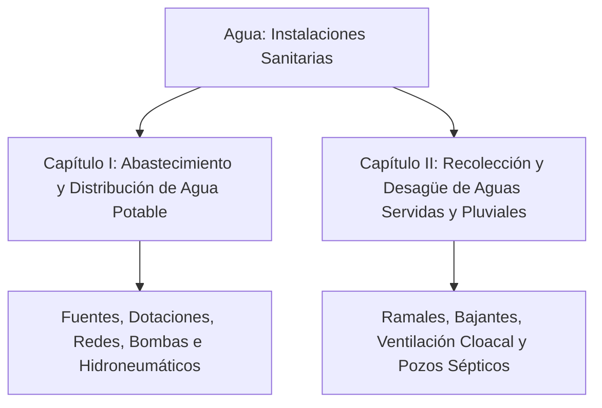

# Referencia Técnica: Agua — Instalaciones Sanitarias en los Edificios

- **Archivo Original:** [agua-instalaciones1.pdf](file:///g:/My%20Drive/MDCP/References/agua-instalaciones1.pdf)
- **Autor:** Arq. Luis A. López R. (mismo autor del *Manual del Constructor Popular*).
- **Expresión Gráfica y Diseño:** Taylor Valmore Beltrán Sánchez, Alejandro Herrera y Luis López.
- **Editorial y Año:** Editorial Betanzos (Caracas, Venezuela). Edición de prueba (Marzo 1990) / Reimpresión (Abril 1990). ISBN 980-6221-48-6.
- **Extensión:** 280 páginas con dibujos axonométricos a mano alzada, esquemas isométricos de tuberías, tablas de cálculo hidráulico y detalles constructivos.
- **Enfoque Principal:** Guía visual y de ingeniería práctica para el diseño, cálculo e instalación de redes hidrosanitarias (abastecimiento de agua potable, bombas, desagües de aguas servidas, ventilación y saneamiento descentralizado mediante pozos sépticos).

---

## 1. Importancia y Relación con el Manual del Constructor Popular

Este libro es la **obra hermana especializada** del *Manual del Constructor Popular*. Mientras el manual general cubre la albañilería y la estructura, *Agua: Instalaciones Sanitarias* profundiza exhaustivamente en lo que el autor llama **"las venas de la casa"**.

Aporta un valor incalculable para el *Manual del Constructor Popular Colombiano* porque:
1. **Muestra las redes en 3D (Isométricos):** La plomería y la fontanería suelen ser difíciles de entender en planos bidimensionales. El autor dibuja todas las tuberías, codos, tes, sifones y reducciones en perspectiva isométrica real.
2. **Saneamiento rural e independiente:** Es una de las guías más detalladas en español sobre cómo diseñar y construir **tanques sépticos, trampas de grasa y campos de infiltración** para comunidades que no cuentan con alcantarillado público (como ocurre en las veredas de Buenaventura, el Pacífico y zonas rurales de Colombia).
3. **El principio de la ventilación cloacal:** Explica con claridad gráfica por qué los sifones de los baños huelen mal o se desvacían ("chupado del sello de agua") y cómo solucionarlo con una tubería de ventilación.

---

## 2. Estructura Temática y Contenidos

El libro está estructurado en dos grandes capítulos maestros:

### CAPÍTULO I: Abastecimiento y Distribución de Agua Potable (pp. 4 - 150)
1. **Fuentes de Abastecimiento:**
   - Captación de agua de lluvia (techos limpios, canaletas y primer desvío de agua sucia).
   - Manantiales y tomas superficiales por gravedad.
   - Pozos profundos y superficiales (aljibes).
   - Conexión a red pública de acueducto.
2. **Sistemas de Distribución en Edificaciones:**
   - *Sistema Directo:* Conexión directa desde la red pública sin almacenamiento (solo viable con presión continua garantizada).
   - *Sistema por Gravedad (Tanque Elevado):* La red llena el tanque superior en horas de presión nocturna y abastece por gravedad durante el día.
   - *Sistema Combinado (Estanque Bajo + Bomba + Tanque Alto):* El más común cuando la presión del acueducto es insuficiente para subir al techo.
   - *Sistema Hidroneumático:* Bomba con tanque de presión de membrana para abastecer con presión uniforme constante.
3. **Dotaciones de Agua Potable:**
   - Viviendas unifamiliares y multifamiliares:
     - 1 dormitorio: 500 litros/día.
     - 2 dormitorios: 850 litros/día.
     - 3 dormitorios: 1.200 litros/día.
     - 4 dormitorios: 1.350 litros/día.
   - Escuelas, internados, hospitales, locales comerciales y áreas verdes.
4. **Cálculo de Diámetros y Pérdidas de Carga (Método de Hunter):**
   - Asignación de **Unidades de Gasto / Unidades Mueble (Hunter)** por pieza sanitaria (inodoro con tanque = 3 a 5 UG; lavamanos = 1 UG; ducha = 2 UG; fregadero de cocina = 2 a 3 UG; lavadero = 2 UG).
   - Curvas de simultaneidad para convertir Unidades de Gasto a caudal probable en Litros/segundo.
   - Pérdidas por fricción en tuberías de PVC y accesorios (codos a 90°, tes, válvulas de retención / cheque, válvulas de compuerta).
   - Presión mínima residual requerida en la ducha o fluxómetro: mínimo 2.0 a 3.0 metros de columna de agua (0.2 a 0.3 bar).
5. **Equipos de Bombeo y Agua Caliente:**
   - Selección de motobombas (caballos de fuerza HP según caudal y altura dinámica total).
   - Redes de agua caliente: calentadores de gas y eléctricos, dilatación térmica de tuberías y circuitos por termosifón.

### CAPÍTULO II: Recolección de Aguas Servidas y Pluviales (pp. 151 - 280)
1. **Principios del Desagüe Sanitario por Gravedad:**
   - Pendientes obligatorias: **1.5% a 2%** para tuberías de 3" y 4"; **2% a 3%** para tuberías de 2".
   - Regla de oro: Menos del 1% produce sedimentación de heces y sólidos; más del 4% hace que el agua corra más rápido que los sólidos, dejando la materia fecal estancada en el tubo.
   - Uniones a 45°: Queda terminantemente prohibido usar tes a 90° en horizontal para desagües; siempre deben usarse yes (Y) a 45° o codos de 45° para garantizar flujo laminar sin turbulencias.
2. **Ventilación Cloacal (El corazón del sistema sanitario):**
   - Función: Permitir la salida de los gases tóxicos y explosivos de la cloaca (metano y sulfhídrico) hacia la atmósfera por encima del techo, y equilibrar presiones para evitar que el sifón se vacíe por sifonamiento.
   - Tipos de ventilación:
     - *Ventilación individual:* Tubo de ventilación conectado a cada sifón.
     - *Ventilación en circuito o húmeda:* Un ramal ventila a varios aparatos alineados.
     - *Columna o bajante de ventilación principal:* Termina abierta a los 4 vientos a 30-50 cm por encima de la cumbrera del techo.
3. **Disposición de Aguas Negras en Zonas sin Alcantarillado:**
   - **Trampa de Grasas (Cocina):** Debe instalarse antes del pozo séptico. La grasa flota y forma una costra superficial que, si entra al pozo séptico o al campo de infiltración, impermeabiliza la tierra y causa el colapso del sistema.
   - **Tanque Séptico de Dos Compartimientos:**
     - Proceso anaeróbico: sedimentación de sólidos en el fondo (lodos) y flotación de natas.
     - Compartimiento 1: 2/3 del volumen total; Compartimiento 2: 1/3 del volumen.
     - Pantallas o tuberías en "T" a la entrada y salida para evitar que las natas pasen al efluente.
     - Dimensionamiento mínimo: volumen útil no menor a 1.5 a 2.0 $m^3$ para una vivienda familiar de 5 a 6 personas.
   - **Campos de Percolación y Zanjas de Infiltración:**
     - Tuberías perforadas de PVC de 4" colocadas con pendiente de 0.2% a 0.5% sobre cama de grava limpia de 30 cm de espesor y cubiertas con geotextil o plástico para que no se obstruyan con tierra.
     - Prueba de percolación: medición del tiempo de descenso de 2.5 cm de agua en un hoyo de prueba para determinar los metros lineales de zanja requeridos.
   - **Sumideros y Pozos de Absorción:** Alternativa vertical cuando el terreno no tiene espacio superficial para zanjas largas.
4. **Ergonomía y Espacios Mínimos de Aparatos Sanitarios:**
   - Distancias mínimas de eje a pared: inodoro a 40 cm del muro lateral; separación libre al frente del inodoro: mínimo 60 cm.
   - Alturas estándar de salidas hidráulicas y desagües empotrados en pared y piso.

---

## 3. Relevancia Directa para el *Manual del Constructor Popular Colombiano*

Este libro es la referencia principal para diseñar el **Módulo 4 (Las Venas de la Casa - Agua y Saneamiento)** del plan general:
1. **Los Isométricos Didácticos:** Adoptar el estilo gráfico de López R. para ilustrar la batería de baño completa (inodoro + lavamanos + ducha) en un solo dibujo en perspectiva donde se vea la tubería de agua fría, agua caliente, desagüe sanitario y tubo de ventilación con sus diámetros y accesorios exactos.
2. **El Manual de Autoconstrucción del Pozo Séptico:** Extraer las dimensiones y planos de corte de los tanques sépticos de dos cámaras y trampas de grasa, indispensables para comunidades como Limoncito y Guadualito en Buenaventura que no disponen de red pública de alcantarillado.
3. **El Código de Colores y Pendientes:** Resumir en tablas sencillas el diámetro según el artefacto (Inodoro: 3" o 4"; Ducha y Lavamanos: 2"; Fregadero: 2"; Bajante principal: 3" o 4").
