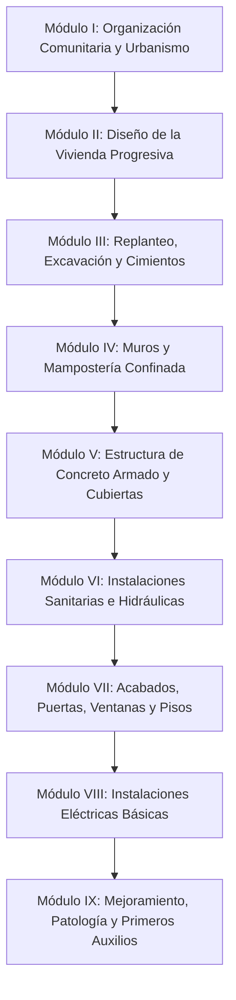

# Referencia Técnica: Manual del Constructor Popular

- **Archivo Original:** [manual-del-constructor-popular.pdf](file:///g:/My%20Drive/MDCP/References/manual-del-constructor-popular.pdf)
- **Autor:** Arq. Luis A. López R. (con la colaboración de Ing. Miguel Zaragoza y diseño de Milagros A. Benítez T.).
- **Edición y Año:** Edición N° 13 (1992), Maracay, Estado Aragua, Venezuela. Depósito Legal LF. 85-3428.
- **Extensión:** 245 páginas ilustradas a mano alzada con rotulación técnica manual y viñetas explicativas.
- **Enfoque Principal:** Autoconstrucción progresiva comunitaria y asistida, ayuda mutua, urbanismo popular y construcción sismo-resistente artesanal pero rigurosa.

---

## 1. Propósito y Filosofía de la Obra

El *Manual del Constructor Popular* es uno de los hitos editoriales latinoamericanos más influyentes en el ámbito de la vivienda de interés social y autoconstrucción. Su filosofía parte de reconocer que:
1. **La autoconstrucción es un hecho real e irreversible:** Las familias de bajos recursos construyen sus viviendas con sus propias manos, con o sin asesoría técnica.
2. **El conocimiento técnico debe democratizarse:** Traduce la ingeniería civil, la sismorresistencia y las buenas prácticas constructivas a un formato visual, directo, en viñetas secuenciales, accesible incluso para personas con bajo nivel de alfabetización técnica.
3. **Organización comunitaria y esfuerzo solidario:** Fomenta la ayuda mutua ("convites", "mingas" o "fainas") y el trabajo por grupos familiares para abaratar costos y garantizar viviendas dignas.

---

## 2. Estructura y Tabla de Contenidos

El libro está organizado de manera secuencial, acompañando a una comunidad y a una familia desde la obtención del lote hasta los acabados y ampliaciones futuras:

### Detalle de Secciones y Páginas:

1. **Principios de Ayuda Mutua y Urbanismo Popular (pp. 1 - 20):**
   - Cooperación comunitaria entre familias en horas libres.
   - Requerimientos urbanos: reserva de espacio para escuela, dispensario médico, parques, iglesia y vías peatonales vs. vehiculares.
   - Dimensiones de lotes populares: parcelas de 180 m² (9x20 m), 120 m² (6x20 m) y 90 m² (4.5x20 m); densidad habitacional por hectárea.
2. **Criterios de Diseño y Espacios Mínimos (pp. 21 - 45):**
   - Concepto de **Vivienda Progresiva (Núcleo Básico)**: sala-comedor-cocina integrados, baño funcional completo y alcoba inicial, planificada para crecer en 2 niveles.
   - Medidas mínimas funcionales: cocina (muebles, fregadero, circulación), baño (distancias mínimas entre inodoro, lavamanos y ducha: 1.20 x 2.10 m o 1.50 x 1.50 m), dormitorios (mínimo 2.80 x 3.00 m).
   - Ventilación e iluminación natural cruzada: relación entre área de ventana y área del piso (mínimo 1/8 o 1/10 para iluminación, 1/12 para ventilación).
   - Distribuciones tipo según el ancho de fachada:
     - Casas de 8 metros de frente.
     - Casas de 7 metros de frente.
     - Casas de 6 metros de frente.
     - Casas de 5 metros de frente.
     - Casas de 4 metros de frente (lotes angostos).
3. **Preparación del Terreno y Replanteo (pp. 46 - 75):**
   - Herramientas de trazo: cinta métrica, manguera transparente para niveles, plomada, hilo de nylon, escuadra de albañil, caballetes / vallas de madera.
   - Nivelación con manguera de agua: purga de burbujas de aire, marcado de cotas a +1.00 m de referencia.
   - Trazado de escuadras con el triángulo rectángulo **3-4-5** (Teorema de Pitágoras).
   - Colocación de caballetes y plomadas para fijar los ejes de muros y cimientos.
   - Excavación de zanjas: profundidad según el firme del suelo (mínimo 50 a 80 cm), achique y compactación de fondo.
4. **Cimentación y Losas de Piso (pp. 76 - 101):**
   - Cimientos corridos de concreto ciclópeo (concreto 1:2:3 con 40% de piedra limpia de río o cantera de 10 a 20 cm).
   - Viga de riostra / viga de amarre inferior: armado de 4 cabillas (varillas) corrugadas con flejes (estribos).
   - Colocación de tuberías de drenaje sanitario embutidas antes del vaciado del contrapiso.
   - Relleno compactado con recebo/granzón en capas de 15 cm.
   - Placa de contrapiso: espesor mínimo 8 a 10 cm con malla electrosoldada o varillas de repartición.
5. **Mampostería Confinada y Muros (pp. 102 - 120):**
   - Tipos de bloques de concreto y ladrillos de arcilla.
   - Mortero de pega: dosificación 1:3 y 1:4 (cemento : arena lavada).
   - Técnica de pegada: humedecer unidades de arcilla, controlar nivel y plomada cada 2 hiladas, espesor de junta (1.0 a 1.5 cm), trabado a media pieza ("rompejunta").
   - Machones / Columnetas de amarre: anclaje de varillas desde la viga de riostra, amarre dentado del muro con la columneta para garantizar monolitismo sísmico.
6. **Estructura de Concreto Armado y Techos (pp. 121 - 169):**
   - Dosificación y mezclado manual del concreto: proporciones volumétricas (1 saco de cemento : 2 cajones de arena : 3 cajones de grava : cantidad justa de agua).
   - Encofrados y formaletas de madera: testeros, puntales, pies de amigo, uso de desmoldante (aceite quemado o emulsión).
   - Armado del acero: dobleces a 90° y 135° con patas o ganchos estándar, traslapos mínimos (40 a 50 veces el diámetro de la varilla), distanciamiento de flejes (más juntos en los extremos cerca de los nudos: cada 10 cm, y cada 20 cm al centro).
   - Chuzado / vibrado manual del concreto con varilla lisa para evitar "hormigueros" (panales o coqueras).
   - Curado del concreto: mojado continuo durante al menos 7 días.
   - Cubiertas: correas de madera o tubulares de acero, anclaje seguro con pernos o ganchos contra succión de viento, tejas de zinc, asbesto-cemento o teja criolla de arcilla, pendiente mínima según material (mínimo 20% a 25%).
7. **Instalaciones Sanitarias e Hidráulicas (pp. 170 - 186):**
   - Trazado de redes de aguas servidas (PVC drenaje): pendientes mínimas del 1.5% al 2%.
   - Cajas de inspección / tanquillas (dimensiones 40x40 cm o 50x50 cm con cañuela en fondo para evitar sedimentos).
   - Tuberías de ventilación cloacal para proteger los sellos hidráulicos de los sifones.
   - Soluciones rurales / sin alcantarillado: pozo séptico de dos cámaras, zanja de absorción/infiltración y trampa de grasas en cocina.
8. **Instalaciones Eléctricas Básicas (pp. 187 - 206):**
   - Acometida, medidor y tablero de breakers (caja de interruptores termomagnéticos).
   - Separación de circuitos: circuito de iluminación (cable AWG #14, breaker 15A), circuito de tomas generales (cable AWG #12, breaker 20A) y circuito especial de cocina/ducha eléctrica (cable AWG #10, breaker 30A).
   - Tubería conduit empotrada, cajas de paso (octogonales y rectangulares 4x2 / 4x4), polo a tierra obligatorio con varilla cooperweld.
9. **Acabados, Pisos y Carpintería (pp. 207 - 225):**
   - Pañete / revoque / friso: maestreado, aplicación de mortero 1:3 o 1:4, acabado con llana de madera y metálica.
   - Pendientes en pisos de baños y patios (1% a 2% hacia sifón).
   - Instalación de marcos de puertas y ventanas con mortero y grapas de anclaje.
10. **Mantenimiento, Patologías y Seguridad (pp. 226 - 245):**
    - Reparación de grietas superficiales vs. fallas estructurales.
    - Protección contra humedad ascendente en muros (impermeabilización de sobrecimiento).
    - Primeros auxilios en la construcción: cortes, caídas, quemaduras por cemento, insolación y reanimación básica.

---

## 3. Elementos Gráficos y Metodológicos a Rescatar

El *Manual del Constructor Popular* destaca por soluciones pedagógicas que deben ser adaptadas en el nuevo manual colombiano:
1. **La "Escuadra 3-4-5":** Enseña con dibujos a gran escala cómo medir 3 metros por un cateto, 4 metros por el otro, y verificar que la hipotenusa cierre exactamente en 5 metros.
2. **El "Vaciado del Concreto y las Coqueras":** Ilustra con gran crudeza lo que pasa cuando no se "chuza" el concreto: el aire queda atrapado, el acero queda expuesto y la columna pierde hasta el 70% de su capacidad.
3. **El Detalle de los Estribos (Flejes) Confinantes:** Muestra claramente el concepto del *confinamiento*: cómo los flejes evitan que las varillas longitudinales se "abran como paraguas" ante la compresión sísmica.
4. **La "Traba" de la Mampostería:** Diagramas que muestran el error crítico de dejar "juntas continuas" verticales en lugar de traslapar los ladrillos al menos a 1/3 o 1/2 longitud.

---

## 4. Adaptaciones Necesarias para Colombia (Tropicalización NSR-10)

Si bien los conceptos de albañilería del manual de López R. son universales, el manual venezolano original requiere las siguientes adecuaciones a la normatividad y práctica colombiana:
*   **Terminología:**
    *   *Cabillas* $\rightarrow$ **Varillas de acero corrugado** o "hierro".
    *   *Machones* $\rightarrow$ **Columnetas de amarre** o columnetas de confinamiento (NSR-10 Título E).
    *   *Vigas de corona / riostras* $\rightarrow$ **Vigas de confinamiento o vigas de amarre** (inferior, de entrepiso y de cubierta).
    *   *Friso* $\rightarrow$ **Pañete o revoque**.
    *   *Tanquillas* $\rightarrow$ **Cajas de inspección**.
    *   *Cachimbas / empotramientos* $\rightarrow$ **Acometida sanitaria y sifón de corte**.
*   **Normativa Estructural:**
    *   El manual original trabaja con códigos Covenin / práctica venezolana de los años 80-90. En Colombia, debe regirse por **NSR-10 Título E** (para mampostería confinada) y **NSR-10 Título G** (para maderas).
    *   La NSR-10 colombiana prohíbe el uso de muros no confinados y exige longitudes mínimas de muros estructurales en ambas direcciones (densidad de muros).
*   **Incorporación del Módulo de Madera y Palafitos:**
    *   El manual original es casi 100% concreto y mampostería de bloque. Para Colombia (especialmente Pacífico, Buenaventura, Chocó y Amazonía), se requiere desarrollar el módulo integral de **madera estructural y palafitos**, inexistente en la obra de López R.
