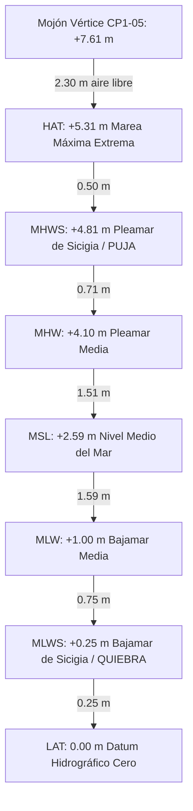

# Datums Hidrográficos y Geodésicos: Estación Vértice CP1-05 (Buenaventura)
**Fuente Oficial:** Dirección General Marítima (DIMAR) - Red Hidrográfica de Referencia Vertical (RHRV)  
**Documento Fuente:** `dimarshn_datum_cp1-05_2022.pdf` / Cartera de Metadatos Vértices Geodésicos  
**Proceso / Formato:** Gestión de la Información Hidrográfica (Código M14-00-FOR-038)  

---

## 1. Localización y Coordenadas Geodésicas del Vértice CP1-05

* **Ubicación General:** Bahía de Buenaventura, junto a la Isla Cascajal, en cercanías de la Sociedad Portuaria e Industrial de Agua Dulce (SPIA).
* **Ubicación Específica:** Instalaciones de TCBUEN (Terminal de Contenedores de Buenaventura), en el patio de descargas y maniobras, costado sur.
* **Monumentación:** Mojón incrustado en concreto. Objeto de referencia: poste a $5.16\text{ m}$ con azimut $225^\circ\text{ SE}$.
* **Municipio / Departamento:** Buenaventura, Valle del Cauca.

### Coordenadas Oficiales (WGS84 / GRS80 - Época 2022.0)
* **Latitud Geográfica:** `3° 53' 30.3162" N`
* **Longitud Geográfica:** `77° 02' 31.83677" W`
* **Altura Elipsoidal ($h$):** `22.3227 m`
* **Velocidades Tectónicas:** $v_{Lat} = +0.014\text{ m/año}$, $v_{Lon} = +0.0059\text{ m/año}$

### Coordenadas Planas Nacionales
* **Sistema CTM12:** Norte: `1.989.116,061 m` | Este: `4.551.045,140 m`
* **Sistema UTM (Zona 18N):** Norte: `430.436,823 m` | Este: `273.229,459 m`

### Alturas y Ondulación Geoidal
* **Altura del Vértice sobre el Datum LAT:** **$7.6130\text{ m}$**
* **Separación Elipsoide - Datum LAT:** $14.71\text{ m}$
* **Altura Ortométrica ($H$):**
  * Modelo GEOCOL 2004: $4.3033\text{ m}$ (diferencia vértice: $-3.31\text{ m}$)
  * Modelo EGM 2008: $5.8479\text{ m}$ (diferencia vértice: $-1.77\text{ m}$)
* **Ondulación Geoidal ($N$):**
  * GEOCOL 2004: $18.0194\text{ m}$
  * EGM 2008: $16.4748\text{ m}$

---

## 2. Valores Numéricos de los Datums Hidrográficos (Referencia Oficial Vértice CP1-05)

A partir de la calibración métrica lineal del diagrama de mareas oficial ($1.00\text{ m} = 127.0\text{ px}$ en alta resolución, anclado al mojón CP1-05 a $+7.613\text{ m}$), los valores exactos en metros son:

| Sigla | Nombre en Inglés | Descripción Técnica en Español | Altura s/ LAT (m) | Relativo a MSL (m) | Distancia bajo el Vértice (m) |
| :--- | :--- | :--- | :---: | :---: | :---: |
| **VÉRTICE** | **CP1-05 Marker** | **Cota física del mojón geodésico** | **+7.61 m** | **+5.02 m** | **0.00 m** |
| **HAT** | Highest Astronomical Tide | Marea astronómica más alta | **+5.31 m** | **+2.72 m** | **2.30 m** |
| **MHWS** | Mean High Water Springs | Promedio de pleamares de sicigia (*Puja*) | **+4.81 m** | **+2.22 m** | **2.80 m** |
| **MHHW** | Mean Higher High Water | Promedio de la pleamar más alta diaria | **+4.30 m** | **+1.71 m** | **3.31 m** |
| **MHW** | Mean High Water | Promedio de todas las pleamares | **+4.10 m** | **+1.51 m** | **3.51 m** |
| **MSL** | Mean Sea Level | **Nivel medio del mar (Datum Cero Medio)** | **+2.59 m** | **0.00 m** | **5.02 m** |
| **MLW** | Mean Low Water | Promedio de todas las bajamares | **+1.00 m** | **-1.59 m** | **6.61 m** |
| **MLLW** | Mean Lower Low Water | Promedio de la bajamar más baja diaria | **+0.84 m** | **-1.75 m** | **6.77 m** |
| **MLWS** | Mean Low Water Springs | Promedio de bajamares de sicigia (*Quiebra*) | **+0.25 m** | **-2.34 m** | **7.36 m** |
| **LAT** | Lowest Astronomical Tide | **Marea astronómica más baja (Cero Carta)** | **0.00 m** | **-2.59 m** | **7.61 m** |

---

## 3. Rangos y Amplitudes de Marea en Buenaventura

* **Rango Astronómico Extremo ($\text{HAT} - \text{LAT}$):** **$5.31\text{ m}$** (amplitud máxima teórica).
* **Rango de Mareas Vivas o Sicigia ($\text{MHWS} - \text{MLWS}$):** **$4.56\text{ m}$** (la diferencia real entre marea llena y seca en días de *puja*).
* **Rango Medio ($\text{MHW} - \text{MLW}$):** **$3.10\text{ m}$**.

---

## 4. Aplicación Práctica de Ingeniería para Limoncito y Guadualito (Río Dagua)

La estación CP1-05 está ubicada en la entrada de la Bahía interior de Buenaventura, a aproximadamente **10–12 km en línea recta** de la desembocadura del Río Dagua donde se asientan Guadualito y Limoncito. Esta información tiene tres implicaciones directas en el diseño de viviendas palafíticas:

### A. Efecto de Represamiento de Marea (*Cuña Salina*)
* Cuando la bahía alcanza la **Pleamar de Sicigia (MHWS = +4.81 m)** o la marea astronómica máxima (**HAT = +5.31 m**), el mar empuja y frena la descarga del Río Dagua.
* El nivel del agua en Guadualito y Limoncito sube drásticamente, no solo por el agua marina que entra, sino porque el caudal del río se represa aguas arriba.
* **Cota Mínima de Piso Terminado ($NPT_{min}$):** La plataforma habitable de las viviendas palafíticas debe situarse por encima del nivel HAT más la sobreelevación por creciente del río y un borde libre mínimo de $0.80\text{ m}$:
  $$\text{Altura de Plataforma Recomendada} \ge 2.50\text{ a }3.00\text{ m sobre el lecho del estero/suelo natural}$$

### B. Evaluación de la Licuación de Suelos durante el Sismo
* Al oscilar la marea en un rango de **$4.56\text{ m}$**, la napa freática en Guadualito y Limoncito se satura dos veces al día.
* Si el terremoto ocurre durante marea alta (pleamar), los poros del suelo aluvial y los fangos de manglar están bajo máxima presión hidrostática, lo que dispara el riesgo de **licuación de suelos** (el fango pierde toda resistencia y los pilotes no arriostrados se hunden o se abren de patas).

### C. Ventana de Trabajo y Navegación para la Misión de Campo
* Para entrar con la lancha sin encallar en playones de lodo ni golpear troncos en el fondo, la navegación debe programarse alrededor de la **media marea subiendo** (cota MSL hacia MHW, entre $+2.60\text{ m}$ y $+4.10\text{ m}$).
* La inspección visual de las bases de los pilotes y la búsqueda de fisuras en el suelo de orilla debe hacerse en **bajamar (MLW a MLWS)** para poder caminar sobre el fango expuesto con botas pantaneras.

